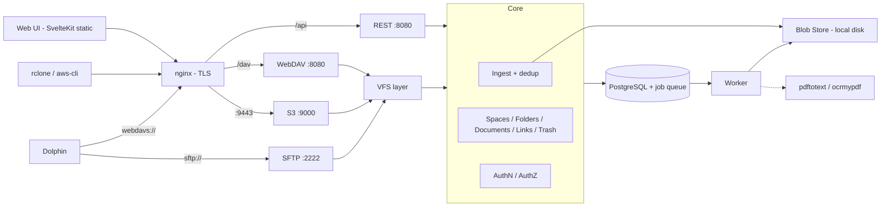

# PLAN.md — tildoc: Self-Hosted Document Management

## Goal

Build **tildoc** — a self-hosted, multi-user document management system inspired
by Immich's architecture and UI philosophy, but focused on documents.

- **Accept every file type.** Supported types (PDF, plain text) get advanced
  services (text extraction, OCR, searchable PDF, full-text search). All other
  files are stored, versioned, listed and downloadable.
- Documents are organized in **Spaces** — personal (user-owned) or **Team**-owned.
- Inside a space, documents live in a **folder hierarchy**. Imported structures
  are preserved as dropped, but can be **remapped** freely without touching files.
- Access via **Web UI** (search-driven details list, customizable columns) and
  **file protocols**: S3-compatible API, WebDAV, SFTP (Dolphin/KDE on Arch Linux
  as primary desktop client).
- Architecturally ready for ML-powered search/classification and additional
  document types without rewriting core components.

**Scope of this build:** Phases 0–6 (incl. OCR). Embeddings/ML classification
remain future work.

---

## Design Principles

### Originals Are Sacred

- Uploaded bytes are never modified. Blobs are **content-addressed** (SHA-256), immutable.
- Overwriting creates a **new version**; previous versions remain.
- Deleting is a **soft delete** (trash with retention, then purge + blob GC).
- Derived artifacts (text, searchable PDF) are keyed by **blob hash** and can be regenerated.

### Never Store Twice (SHA-256 Deduplication)

| Situation | Result |
|-----------|--------|
| Hash unknown | Store blob, create document + link at target path |
| Hash known, live document with this content **in the target space** | No new blob/document — only a new **link** to the existing document |
| Hash known, only **in other spaces** | Blob reused; new document in target space (spaces isolated) |
| Target path already holds a document (overwrite) | New **version** of that document; same hash as current → no-op |

- Copy within a space (WebDAV/SFTP/S3 `CopyObject`, UI) = new link to the same document.
  S3 copy+delete "renames" therefore keep document identity and history.
- Derived artifacts are per blob → deduplicated files are instantly searchable.
- Dedup happens server-side after streaming to a temp file.

> **WARNING (privacy):** no "do you have hash X?" endpoint across spaces/users.
> Responses (timing, ETag) must not differ between new and deduplicated uploads.

### Copy-on-Write for Multi-Linked Documents

Writing a new version **through a link** whose document has more than one live
link forks that link into its own document (history copied, new version appended).
Other links keep the old content — filesystem semantics for users.

### Identity ≠ Link

A document's identity (ID, versions, metadata, derived data) is independent of
where it appears. Moving/renaming documents or subtrees is a metadata operation.
The original import location is recorded as **provenance** and never lost.

### Adapters Over Core

REST, S3, WebDAV and SFTP are thin adapters over a shared **core** (ingest,
documents/folders/links, authz) and a path-based **VFS layer**. No adapter
touches storage or the database directly.

### Processing Pipeline

File type detection is **content-based** (magic bytes, `http.DetectContentType`,
UTF-8 validation). The worker dispatches by MIME type; new types = new processor.

| Category | Detection | Processing |
|----------|-----------|------------|
| Digital PDF | `pdftotext` yields text on every page | Extract text → index |
| Scanned / mixed PDF | Pages without text (form-feed split) | `ocrmypdf --skip-text` → text + derived searchable PDF |
| Text | Valid UTF-8, no NUL | Index content |
| Other | — | `unsupported` (stored, not indexed) |

OCR binary missing → status `ocr_pending`; bulk re-processing available.

---

## Glossary

| Term | Meaning | Protocol mapping |
|------|---------|------------------|
| **Team** | Group of users with roles (owner, admin, member, viewer) | — |
| **Space** | Top-level container, personal or team-owned; isolation boundary | S3 bucket; WebDAV/SFTP top-level folder |
| **Folder** | Node in the folder tree of a space | S3 prefix / dir marker; directory |
| **Document** | Identity: versions, metadata, derived data | — |
| **Link** | Where a document appears: folder + name; 1..N per document | S3 key; file path |
| **Version** | Immutable revision of a document → blob | overwrite creates one |
| **Blob** | Immutable content, SHA-256 addressed (internal) | ETag (MD5) |
| **Import** | Upload batch incl. original drop location (provenance) | per client session |

---

## Core Concepts

- **Teams:** roles viewer (read), member (+write: upload, mkdir, move, version),
  admin (+delete, manage members), owner (+manage team/owners). Multi-team users.
- **Spaces:** unique `slug` (`[a-z0-9-]`, 3–63, S3 bucket rules). Personal space
  auto-created per user. Team spaces created by team admins/owners.
- **Folders:** adjacency list, each space has a root folder. Unique names per
  parent among folders **and** links (enforced in service under parent row lock).
  Deleting a folder soft-deletes all links below (remembering their path), then
  removes the folder rows.
- **Links:** `deleted_path` kept on delete; documents go to trash when their last
  link is deleted. Restore recreates folders as needed. Every document lists all
  its links (UI, REST, WebDAV prop `tildoc:links`, S3 `x-amz-meta-tildoc-links`).
- **Imports / provenance:** `links.original_path` + `import_id`. Rename shortly
  after creation (editor/KIO `.part` save) updates provenance. "Restore original
  structure" per link or per import.
- **Sharing:** deferred. Access purely space-based.

---

## Architecture

- **Single binary** `tildoc` with subcommands: `serve` (REST+WebDAV+S3+SFTP),
  `worker`, `migrate`, `user`.
- **Queue:** Postgres table, `FOR UPDATE SKIP LOCKED`, `LISTEN/NOTIFY` wakeups;
  jobs are enqueued in the same transaction as the ingest.
- **Dependencies:** `pgx/v5`, `golang.org/x/{crypto,net,text,image}`, `pkg/sftp`.
  Everything else stdlib (SigV4, aws-chunked, XML, argon2id via x/crypto, AES-GCM).
- **TLS:** nginx (template `deploy/nginx/`), self-signed cert generated if absent.
  SFTP direct (SSH). nginx must stream (`proxy_request_buffering off`,
  `client_max_body_size 0`), keep `Host` incl. port (`$http_host`) and raw URI.

### Security

- Passwords: argon2id. Sessions: random token, hashed in DB, HttpOnly cookie;
  unsafe methods with cookie auth require `X-Tildoc-CSRF` header.
- Access keys (S3 SigV4, WebDAV/SFTP app passwords): secret AES-256-GCM encrypted
  with master key; scope optional (space, read-only). SSH public keys for SFTP.
- Failed-auth rate limiting per IP + identity.
- File content responses: `X-Content-Type-Options: nosniff`, `CSP: sandbox`
  (except inline PDF), downloads as attachment → no stored XSS on the UI origin.
- Names: NFC-normalized, no `/`, NUL, control chars, `.`/`..`, ≤255 bytes.
- First-run setup endpoint creates the first admin only while no user exists.

---

## Phases

### Phase 0 — Foundation
- [x] git init, `.gitignore`, Go module, layout (`cmd/tildoc`, `internal/*`, `web/`, `deploy/`, `test/`)
- [x] Config from env (`deploy/.env.example` template, `.env` gitignored), slog logging
- [x] Migrations (embedded SQL, own runner)
- [x] Test harness: Postgres in Docker, per-test database from template

### Phase 1 — Data Model & Blob Store
- [x] Schema: users, sessions, access_keys, ssh_keys, teams, team_members, spaces, folders, blobs, documents, document_versions, links, imports, blob_processing, blob_texts, blob_derivatives, jobs, multipart uploads
- [x] Blob store: streaming stage (SHA-256 + MD5 + sniff), atomic commit, open (ReadSeeker + ReaderAt)
- [x] Tests

### Phase 2 — Auth & AuthZ
- [x] Users, argon2id, sessions, access keys (encrypted secrets), SSH keys, rate limiter
- [x] Teams, members, roles, spaces, permission checks
- [x] Tests

### Phase 3 — Core: Ingest, Folders, Links, Trash
- [x] Ingest with dedup / versioning / copy-on-write / provenance; job enqueue
- [x] Folder + link ops (mkdir, move, rename, copy, delete, restore, restore-original), cross-space moves
- [x] Trash purge + blob GC
- [x] VFS layer (path resolution, stat/list/open/put/mkdir/rename/copy/remove)
- [x] Tests

### Phase 4 — REST API & Search
- [x] Setup/login/me, users (admin), keys, teams, spaces, folders, documents, links, uploads (raw streaming PUT with relative path), downloads (original/searchable/version), trash, imports, bulk move, search (tsvector), admin jobs/reprocess
- [x] Integration tests via HTTP

### Phase 4b — Protocol Gateways
- [x] S3: SigV4 (header + presigned), all payload modes (signed, UNSIGNED, aws-chunked signed/unsigned + trailers, CRC32/CRC32C/CRC64NVME/SHA1/SHA256), ListBuckets, Head/GetBucketLocation, CreateBucket (exists → ok), ListObjects V1+V2, Head/Get (Range)/Put/Copy/Delete/DeleteObjects, multipart, dir markers, `x-amz-meta-*`
- [x] WebDAV: `x/net/webdav` on VFS, intercepted MOVE/COPY (versioning-preserving overwrite), Basic auth with app passwords, `tildoc:links` prop
- [x] SFTP: `x/crypto/ssh` + `pkg/sftp` request server on VFS, pubkey + app-password auth, posix-rename
- [x] Integration tests (own SigV4 client validated against AWS test vectors, raw WebDAV, pkg/sftp client)
- [x] Real-client E2E in Docker: aws-cli, rclone (s3, webdav, sftp backends)

