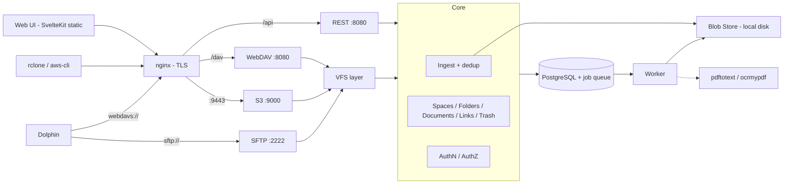

# PLAN.md — tildoc: Self-Hosted Document Management

## Goal

Build **tildoc** — a self-hosted, multi-user document management system inspired
by Immich's architecture and UI philosophy, but focused on documents.

- **Accept every file type.** Supported types (PDF, plain text) get advanced
  services (text extraction, OCR, searchable PDF, full-text search). All other
  files are stored, versioned, listed and downloadable.
- Documents are organized in **Spaces** — personal (user-owned) or **Team**-owned.
- Inside a space, documents live in a **folder hierarchy**. Imported structures
  are preserved as dropped, but can be **remapped** freely without touching files.
- Access via **Web UI** (search-driven details list, customizable columns) and
  **file protocols**: S3-compatible API, WebDAV, SFTP (Dolphin/KDE on Arch Linux
  as primary desktop client).
- Architecturally ready for ML-powered search/classification and additional
  document types without rewriting core components.

**Scope of this build:** Phases 0–6 (incl. OCR). Embeddings/ML classification
remain future work.

---

## Design Principles

### Originals Are Sacred

- Uploaded bytes are never modified. Blobs are **content-addressed** (SHA-256), immutable.
- Overwriting creates a **new version**; previous versions remain.
- Deleting is a **soft delete** (trash with retention, then purge + blob GC).
- Derived artifacts (text, searchable PDF) are keyed by **blob hash** and can be regenerated.

### Never Store Twice (SHA-256 Deduplication)

| Situation | Result |
|-----------|--------|
| Hash unknown | Store blob, create document + link at target path |
| Hash known, live document with this content **in the target space** | No new blob/document — only a new **link** to the existing document |
| Hash known, only **in other spaces** | Blob reused; new document in target space (spaces isolated) |
| Target path already holds a document (overwrite) | New **version** of that document; same hash as current → no-op |

- Copy within a space (WebDAV/SFTP/S3 `CopyObject`, UI) = new link to the same document.
  S3 copy+delete "renames" therefore keep document identity and history.
- Derived artifacts are per blob → deduplicated files are instantly searchable.
- Dedup happens server-side after streaming to a temp file.

> **WARNING (privacy):** no "do you have hash X?" endpoint across spaces/users.
> Responses (timing, ETag) must not differ between new and deduplicated uploads.

### Copy-on-Write for Multi-Linked Documents

Writing a new version **through a link** whose document has more than one live
link forks that link into its own document (history copied, new version appended).
Other links keep the old content — filesystem semantics for users.

### Identity ≠ Link

A document's identity (ID, versions, metadata, derived data) is independent of
where it appears. Moving/renaming documents or subtrees is a metadata operation.
The original import location is recorded as **provenance** and never lost.

### Adapters Over Core

REST, S3, WebDAV and SFTP are thin adapters over a shared **core** (ingest,
documents/folders/links, authz) and a path-based **VFS layer**. No adapter
touches storage or the database directly.

### Processing Pipeline

File type detection is **content-based** (magic bytes, `http.DetectContentType`,
UTF-8 validation). The worker dispatches by MIME type; new types = new processor.

| Category | Detection | Processing |
|----------|-----------|------------|
| Digital PDF | `pdftotext` yields text on every page | Extract text → index |
| Scanned / mixed PDF | Pages without text (form-feed split) | `ocrmypdf --skip-text` → text + derived searchable PDF |
| Text | Valid UTF-8, no NUL | Index content |
| Other | — | `unsupported` (stored, not indexed) |

OCR binary missing → status `ocr_pending`; bulk re-processing available.

---

## Glossary

| Term | Meaning | Protocol mapping |
|------|---------|------------------|
| **Team** | Group of users with roles (owner, admin, member, viewer) | — |
| **Space** | Top-level container, personal or team-owned; isolation boundary | S3 bucket; WebDAV/SFTP top-level folder |
| **Folder** | Node in the folder tree of a space | S3 prefix / dir marker; directory |
| **Document** | Identity: versions, metadata, derived data | — |
| **Link** | Where a document appears: folder + name; 1..N per document | S3 key; file path |
| **Version** | Immutable revision of a document → blob | overwrite creates one |
| **Blob** | Immutable content, SHA-256 addressed (internal) | ETag (MD5) |
| **Import** | Upload batch incl. original drop location (provenance) | per client session |

---

## Core Concepts

- **Teams:** roles viewer (read), member (+write: upload, mkdir, move, version),
  admin (+delete, manage members), owner (+manage team/owners). Multi-team users.
- **Spaces:** unique `slug` (`[a-z0-9-]`, 3–63, S3 bucket rules). Personal space
  auto-created per user. Team spaces created by team admins/owners.
- **Folders:** adjacency list, each space has a root folder. Unique names per
  parent among folders **and** links (enforced in service under parent row lock).
  Deleting a folder soft-deletes all links below (remembering their path), then
  removes the folder rows.
- **Links:** `deleted_path` kept on delete; documents go to trash when their last
  link is deleted. Restore recreates folders as needed. Every document lists all
  its links (UI, REST, WebDAV prop `tildoc:links`, S3 `x-amz-meta-tildoc-links`).
- **Imports / provenance:** `links.original_path` + `import_id`. Rename shortly
  after creation (editor/KIO `.part` save) updates provenance. "Restore original
  structure" per link or per import.
- **Sharing:** deferred. Access purely space-based.

---

## Architecture



- **Single binary** `tildoc` with subcommands: `serve` (REST+WebDAV+S3+SFTP),
  `worker`, `migrate`, `user`.
- **Queue:** Postgres table, `FOR UPDATE SKIP LOCKED`, `LISTEN/NOTIFY` wakeups;
  jobs are enqueued in the same transaction as the ingest.
- **Dependencies:** `pgx/v5`, `golang.org/x/{crypto,net,text,image}`, `pkg/sftp`.
  Everything else stdlib (SigV4, aws-chunked, XML, argon2id via x/crypto, AES-GCM).
- **TLS:** nginx (template `deploy/nginx/`), self-signed cert generated if absent.
  SFTP direct (SSH). nginx must stream (`proxy_request_buffering off`,
  `client_max_body_size 0`), keep `Host` incl. port (`$http_host`) and raw URI.

### Security

- Passwords: argon2id. Sessions: random token, hashed in DB, HttpOnly cookie;
  unsafe methods with cookie auth require `X-Tildoc-CSRF` header.
- Access keys (S3 SigV4, WebDAV/SFTP app passwords): secret AES-256-GCM encrypted
  with master key; scope optional (space, read-only). SSH public keys for SFTP.
- Failed-auth rate limiting per IP + identity.
- File content responses: `X-Content-Type-Options: nosniff`, `CSP: sandbox`
  (except inline PDF), downloads as attachment → no stored XSS on the UI origin.
- Names: NFC-normalized, no `/`, NUL, control chars, `.`/`..`, ≤255 bytes.
- First-run setup endpoint creates the first admin only while no user exists.

---

## Phases

### Phase 0 — Foundation
- [x] git init, `.gitignore`, Go module, layout (`cmd/tildoc`, `internal/*`, `web/`, `deploy/`, `test/`)
- [x] Config from env (`deploy/.env.example` template, `.env` gitignored), slog logging
- [x] Migrations (embedded SQL, own runner)
- [x] Test harness: Postgres in Docker, per-test database from template

### Phase 1 — Data Model & Blob Store
- [x] Schema: users, sessions, access_keys, ssh_keys, teams, team_members, spaces, folders, blobs, documents, document_versions, links, imports, blob_processing, blob_texts, blob_derivatives, jobs, multipart uploads
- [x] Blob store: streaming stage (SHA-256 + MD5 + sniff), atomic commit, open (ReadSeeker + ReaderAt)
- [x] Tests

### Phase 2 — Auth & AuthZ
- [x] Users, argon2id, sessions, access keys (encrypted secrets), SSH keys, rate limiter
- [x] Teams, members, roles, spaces, permission checks
- [x] Tests

### Phase 3 — Core: Ingest, Folders, Links, Trash
- [x] Ingest with dedup / versioning / copy-on-write / provenance; job enqueue
- [x] Folder + link ops (mkdir, move, rename, copy, delete, restore, restore-original), cross-space moves
- [x] Trash purge + blob GC
- [x] VFS layer (path resolution, stat/list/open/put/mkdir/rename/copy/remove)
- [x] Tests

### Phase 4 — REST API & Search
- [x] Setup/login/me, users (admin), keys, teams, spaces, folders, documents, links, uploads (raw streaming PUT with relative path), downloads (original/searchable/version), trash, imports, bulk move, search (tsvector), admin jobs/reprocess
- [x] Integration tests via HTTP

### Phase 4b — Protocol Gateways
- [x] S3: SigV4 (header + presigned), all payload modes (signed, UNSIGNED, aws-chunked signed/unsigned + trailers, CRC32/CRC32C/CRC64NVME/SHA1/SHA256), ListBuckets, Head/GetBucketLocation, CreateBucket (exists → ok), ListObjects V1+V2, Head/Get (Range)/Put/Copy/Delete/DeleteObjects, multipart, dir markers, `x-amz-meta-*`
- [x] WebDAV: `x/net/webdav` on VFS, intercepted MOVE/COPY (versioning-preserving overwrite), Basic auth with app passwords, `tildoc:links` prop
- [x] SFTP: `x/crypto/ssh` + `pkg/sftp` request server on VFS, pubkey + app-password auth, posix-rename
- [x] Integration tests (own SigV4 client validated against AWS test vectors, raw WebDAV, pkg/sftp client)
- [x] Real-client E2E in Docker: aws-cli, rclone (s3, webdav, sftp backends)

### Phase 5 — Web UI
- [x] SvelteKit (Svelte 5, adapter-static, SPA), plain CSS, light/dark
- [x] Setup/login; space/folder tree; details list (sortable, customizable + persisted columns, responsive); search; drag & drop upload preserving folder structure; move/rename/delete/new folder/link; document panel (preview, versions, links, text, status, downloads, new version, reprocess); trash; settings (password, access keys, SSH keys, connection help incl. Dolphin/rclone); teams; admin (users, jobs)
- [x] UI smoke test (Chromium via playwright-core, `test/ui/run.sh`)

### Phase 6 — Worker & OCR
- [x] Job runner (SKIP LOCKED, retries/backoff, stale-lock reclaim, NOTIFY)
- [x] Processors: text, PDF (`pdftotext`), OCR (`ocrmypdf --skip-text`, sidecar text, searchable PDF as derived blob), unsupported
- [x] Periodic: trash purge, blob GC, stale multipart cleanup
- [x] Tests in Docker test image (poppler + ocrmypdf + tesseract deu/eng)

### Phase 7 — Deployment & Docs
- [x] Dockerfile (targets: server, worker incl. OCR tools, web), docker compose (postgres, server, worker, nginx), nginx template + cert generation
- [x] README: setup, Arch/Dolphin client setup (webdavs, sftp, rclone + fuse3 systemd user unit)
- [x] Full-stack smoke test via compose

### Phase 8 — Frontend Rework

**Goal:** a modern, distinctive UI and a document viewer that scales from the
quick side preview up to reading a whole PDF full-window, with page
navigation, zoom, thumbnails and in-document search.

#### Design direction: "light table"

The subject is a personal or team archive of letters, invoices, contracts and
scans. The documents are the content and the UI is the table they lie on.
Only document pages are bright white paper. The chrome sits on a calm, tinted
board, and the viewer puts the pages on a dark stage, like a light box. The
design takes one risk: the **highlighter**. Search hits are marked in
highlighter yellow everywhere: in result snippets, the text layer of a PDF
page, extracted text, and thumbnails of pages that have hits. Everything else
stays quiet.

| Token | Light | Dark | Use |
|-------|-------|------|-----|
| `--board` | `#DCE1DA` | `#1B2024` | app background (grey-green archive board) |
| `--surface` | `#F4F6F2` | `#242B30` | lists, panels, dialogs |
| `--paper` | `#FFFFFF` | `#FFFFFF` | document pages only |
| `--ink` | `#1D2A35` | `#E4E9EC` | text (blue-black ink, not tinted black) |
| `--accent` | `#1F4E79` | `#86AED8` | selection, primary actions (Prussian blue) |
| `--highlight` | `#F2E35B` | `#E2CF45` | search hits (the bold element) |
| `--manila` | `#C49A4A` | `#D3AC5E` | folder icons (functional, not decoration) |
| `--stage` | `#2A3137` | `#15191C` | viewer background |

- **Type:** *Atkinson Hyperlegible Next* everywhere (variable weights,
  tabular figures for sizes and dates). OFL, **self-hosted** under
  `web/static/vendor/fonts` (no font CDN: privacy and CSP). Literata was tried
  for titles and reading text and dropped at the user's request. Scale on 15 px with ratio
  1.2: 12.5 / 15 / 18 / 21.6 / 26. Sentence case throughout, no all-caps labels.
- **Structure means something:** no identical card grid. Settings and admin are
  headed sections divided by rules. Radius has a hierarchy: 4 px for controls,
  8 px for panels, 0 for document pages (paper has square corners). Shadows
  only under paper.
- **Motion:** one orchestrated moment. Opening a document morphs the preview
  page into the viewer (View Transitions API, off under
  `prefers-reduced-motion`). No entrance animations or hover lifts.
- **Copy:** separate labelled fields instead of `PDF · 2 MB · v3` meta strings;
  actions named by outcome ("Move to folder", "Restore version 2"); empty
  states tell the user what to do next ("Drop files here or press U to upload").

#### Shell and file browser

```
┌────────┬──────────────────────────────────────────────┬─────────────────────┐
│ Spaces │  Finance / Invoices / 2026     [search ⌘K]   │  Peek panel         │
│ ▸ Home │ ┌──────────────────────────────────────────┐ │  ┌───────────────┐  │
│ ▾ Team │ │ ▢ Name            Modified   Size  Links │ │  │   page 1      │  │
│   ▸ …  │ │ ▣ invoice-03.pdf  2 Nov      212 KB  2   │◀┼──│   (paper)     │  │
│        │ │ ▢ contract.pdf    28 Oct     1.4 MB  1   │ │  │   scrolls     │  │
│ Trash  │ │ ▢ notes.txt       12 Oct     4 KB    1   │ │  └───────────────┘  │
│ Teams  │ └──────────────────────────────────────────┘ │  Open  Download  ⋯  │
│ ⚙      │   drop zone overlay on drag                  │  Info · Versions …  │
└────────┴──────────────────────────────────────────────┴─────────────────────┘
```

- The left rail holds spaces with the folder tree, then trash, teams and
  settings. It collapses to icons below 1100 px and becomes a drawer on
  mobile.
- File list: a dense table (36 px rows), checkbox multi-select, keyboard
  navigation (↑↓, Enter opens, Space peeks, Del, F2 rename, U upload),
  breadcrumb with drop targets, and a full-area drop overlay showing the
  target folder.
- Peek panel (replaces DocumentPanel):
  - **resizable** from 320 px to 60 % of the window (width saved per browser);
  - preview pages rendered with pdf.js, so the whole PDF already scrolls here;
  - tabs below the preview for Info, Versions, Links and Text.
- ⌘K / Ctrl+K quick search: a palette that jumps to documents and folders.
- Left aligned throughout. Only login and setup are centred, as a single
  column.

#### Document viewer (the core of this phase)

Three levels, one component: **row → peek panel → viewer**. The viewer is its
own route, `/view/[linkId]?page=&q=&v=`:
- it can be bookmarked and deep-linked;
- the browser back button or Esc closes it and returns to the folder, with the
  selection kept.

```
┌──────────────────────────────────────────────────────────────────────────────┐
│ ✕  contract.pdf   ‹ prev  next ›     ◂ 3 / 12 ▸   − 110 % +  Fit ▾   Find  ⓘ │
├──────┬───────────────────────────────────────────────────────┬───────────────┤
│ ▭ 1  │                                                       │ Info drawer   │
│ ▭ 2  │            ┌──────────────────────────┐               │ Original /    │
│ ▣ 3 ●│            │                          │  dark stage   │ Searchable    │
│ ▭ 4  │            │   page 3   ▇▇ highlight  │               │ Versions      │
│ ▭ 5 ●│            │                          │               │ Links (2)     │
│ …    │            └──────────────────────────┘               │ Text          │
│thumbs│            continuous scroll, lazy pages              │ Download      │
└──────┴───────────────────────────────────────────────────────┴───────────────┘
  ● = page contains search hits
```

- **PDF:**
  - pages scroll continuously and only the visible pages ±2 are rendered;
    canvases are released again, so large PDFs stay light;
  - a text layer allows selecting and copying text;
  - **Find** (Ctrl+F inside the viewer) highlights hits and steps through them
    with Enter / Shift+Enter;
  - thumbnails, with markers on pages that have hits;
  - zoom: fit width, fit page, 50–400 %, Ctrl+wheel and pinch;
  - view-only rotation;
  - page input; Original vs Searchable (OCR) toggle; version switcher.
- **Images:** fit or 1:1, zoom and pan, the same stage.
- **Text:** a reading column ≤ 75ch, monospace for code and
  structured types, find with highlights.
- **Other types:** a large file sheet with type, size, versions and links, plus
  Download.
- **Navigation:** `[` / `]` move to the previous or next document in the
  folder. Esc closes.
- **Arriving from search:** the server returns the **page of the first hit**
  (pdftotext keeps `\f` page breaks), so the viewer opens on that page with the
  terms highlighted.
- **Mobile:** full screen; thumbnails and the info drawer become bottom sheets.
- **Print and "open in browser":** download only. See the security note below.

#### Other screens

Search becomes a result list with highlighted snippets, page numbers, a
space/folder/type filter and a row click into the viewer. Trash, Spaces,
Teams, Settings (access keys, SSH keys, connection help), Admin, Login and
Setup are restyled with the new tokens, copy and section structure. Toasts,
modals and the folder picker are redone.

#### Technical notes

- **Dependency:** `pdfjs-dist` 6.4 (Mozilla, Apache-2.0), pinned. It is the only new
  runtime dependency. It is loaded lazily, so the worker loads only when a PDF
  is shown. PDF scripting and XFA are off (the QuickJS engine is not even
  shipped); the CSP forbids JS eval. Links inside PDFs open with
  `noopener,noreferrer` after a confirm prompt, internal links jump to the page.
  Assets (cmaps, standard fonts, WASM decoders, fonts) are copied from the
  pinned npm packages by `web/scripts/vendor-assets.mjs` into the gitignored
  `web/static/vendor/` before `dev` and `build`.
- **Viewer preference:** `users.prefs` (jsonb, `pdf_viewer`: `pdfjs` default |
  `native`), set in *Settings and access → Opening documents*. `native` shows
  PDFs in an iframe with the browser's viewer; only for users with that
  preference does `?inline=1&viewer=native` drop the sandbox CSP (checked
  server-side).
- **CSP (UI):**
  - add `worker-src 'self'`;
  - add `'wasm-unsafe-eval'` to `script-src` (pdf.js v5 decodes
    JPX/JBIG2 images via WASM);
  - `script-src` stays hash-based.
- **Security fix:** inline PDF responses get `CSP: sandbox` too. Today they are
  the one inline type served without it. Since pdf.js fetches the bytes and
  renders them to canvas on the UI origin, the browser's own PDF viewer is no
  longer needed. Entry for HISTORY.md.
- **Server additions:**
  - search results include `page`;
  - a `pages` count in the document DTO (already in `blob_processing`);
  - no new endpoints; byte ranges already work, so pdf.js streams large PDFs.
- **No UI libraries:** components stay in plain Svelte 5 and plain CSS, with
  tokens in `app.css`.

#### Steps

- [x] 8.1 Tokens, self-hosted fonts, base controls (buttons, inputs, tables, tabs, dialogs, toasts), light and dark themes
- [x] 8.2 Shell: rail with folder tree, header with breadcrumb and quick search, responsive drawer
- [x] 8.3 File browser: table, keyboard navigation, selection, drop overlay, empty states
- [x] 8.4 Viewer core: pdf.js loader, lazy page virtualisation, text layer, zoom/fit, page navigation
- [x] 8.5 Viewer features: thumbnails, find with highlights, OCR/version toggle, info drawer, prev/next, image and text modes, mobile sheets
- [x] 8.6 Peek panel on the viewer component (resizable), view-transition open
- [x] 8.7 Server: search hit page, `pages` in DTO, CSP update, sandbox for inline PDF + HISTORY.md
- [x] 8.8 Search, trash, spaces, teams, settings, admin, login/setup restyle
- [x] 8.9 Tests: extend `test/ui/smoke.mjs` (multi-page fixture; open viewer, page jump, find count, OCR toggle, Esc restores selection, mobile, dark, **no CSP/console errors**); Go tests for hit page; screenshot review pass; commit "Phase 8"
- [x] 8.10 Follow-up: one typeface, hints below inputs, full-width subpages, row click shows the preview and the file name opens the viewer

---

## Decisions

| # | Topic | Decision |
|---|-------|----------|
| 1 | File types | Accept all; advanced services for supported types |
| 2 | Structure | Folder tree preserved as dropped; remappable; provenance kept |
| 3 | Overwrite | New version |
| 4 | Sharing | Deferred; space-based access only |
| 5 | S3 implementation | Own, Go stdlib |
| 6 | Deduplication | SHA-256; known file in space → new link only |
| 7 | Desktop protocols | WebDAV **and** SFTP |
| 8 | Libraries | `golang.org/x/*`, `pkg/sftp`, `pgx/v5` |
| 9 | TLS | nginx in front of HTTP adapters |
| 10 | Duplicate in same space | One document, multiple links |
| 11 | Delete link | Only that link; document to trash with last link; all links visible |
| 12 | Terminology | Space, Team, Folder, Document, Link (Blob internal) |
| 13 | PDF text | poppler `pdftotext` |
| 14 | Queue | Postgres (replaces Redis) |
| 15 | Scope | Phases 0–6 incl. OCR |
| 16 | Repo | git, one commit per phase; tests via Docker; no AWS SDK |
| 17 | Write via multi-linked doc | Copy-on-write fork |
| 18 | PDF viewer | pdf.js (`pdfjs-dist`) by default; browser viewer selectable per user |
| 19 | UI font | Atkinson Hyperlegible Next only, self-hosted |
| 20 | Access key secrets | 40 alphanumeric chars (no leading `-` that CLIs parse as a flag) |

## Open Questions

None.
