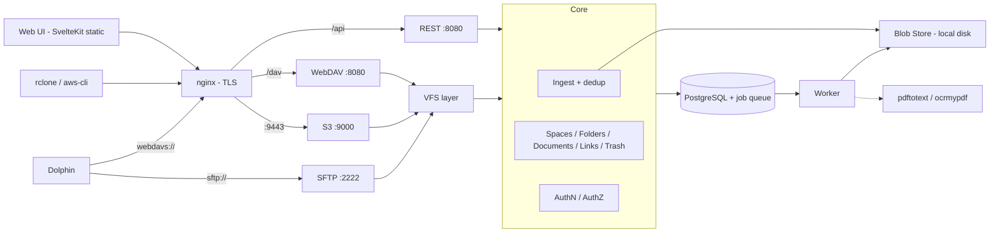
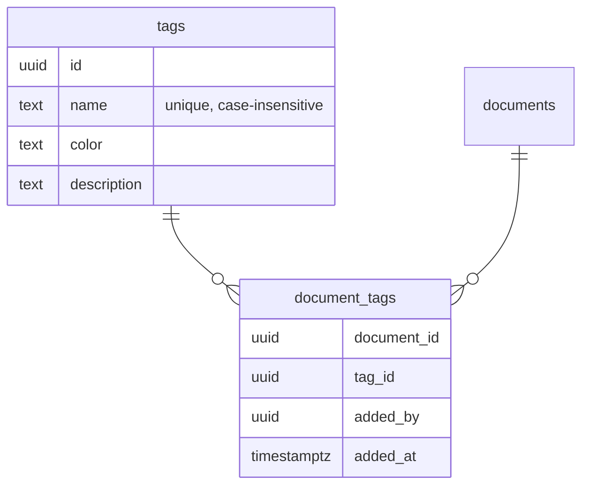
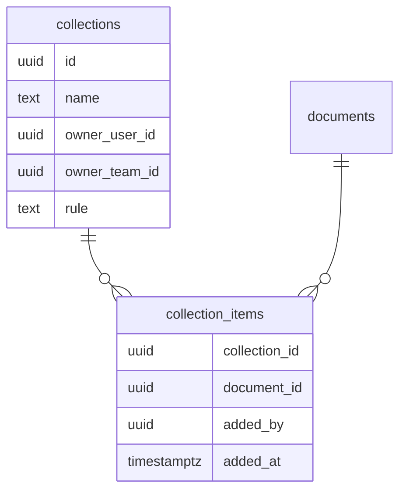
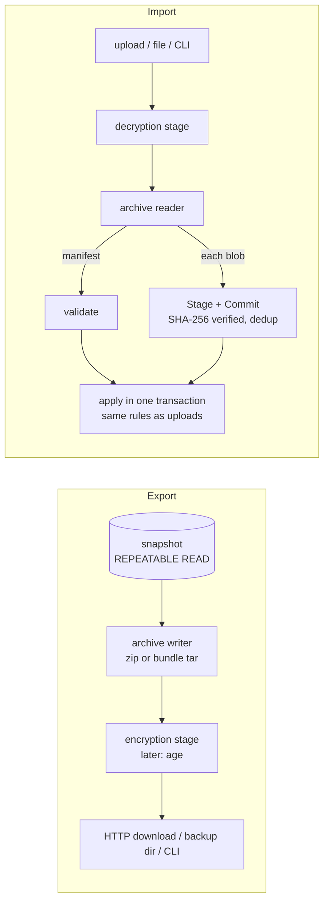
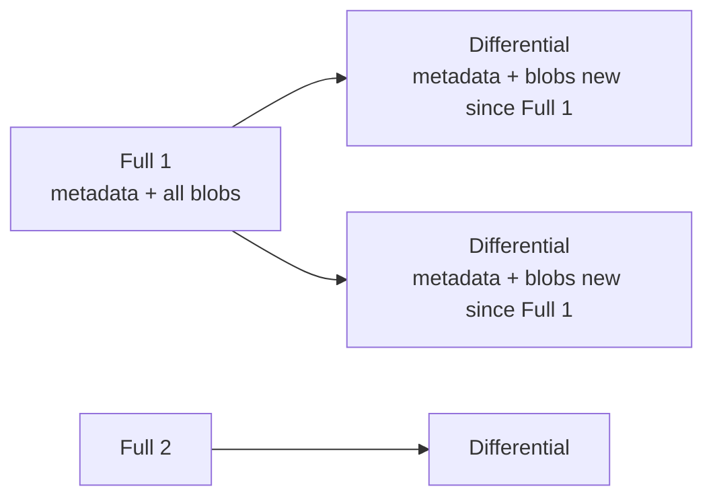
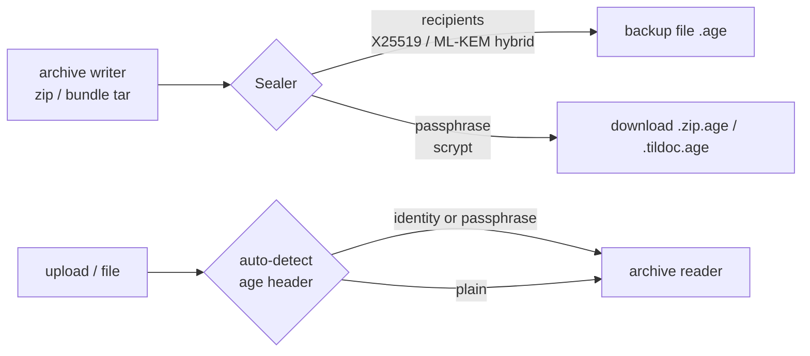
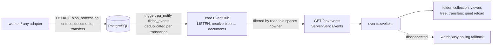
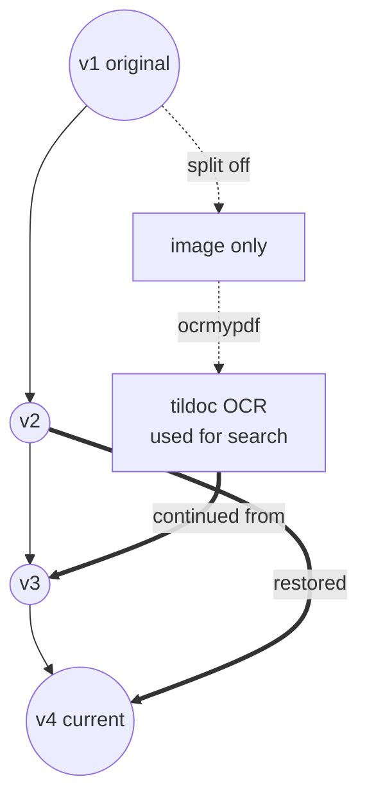
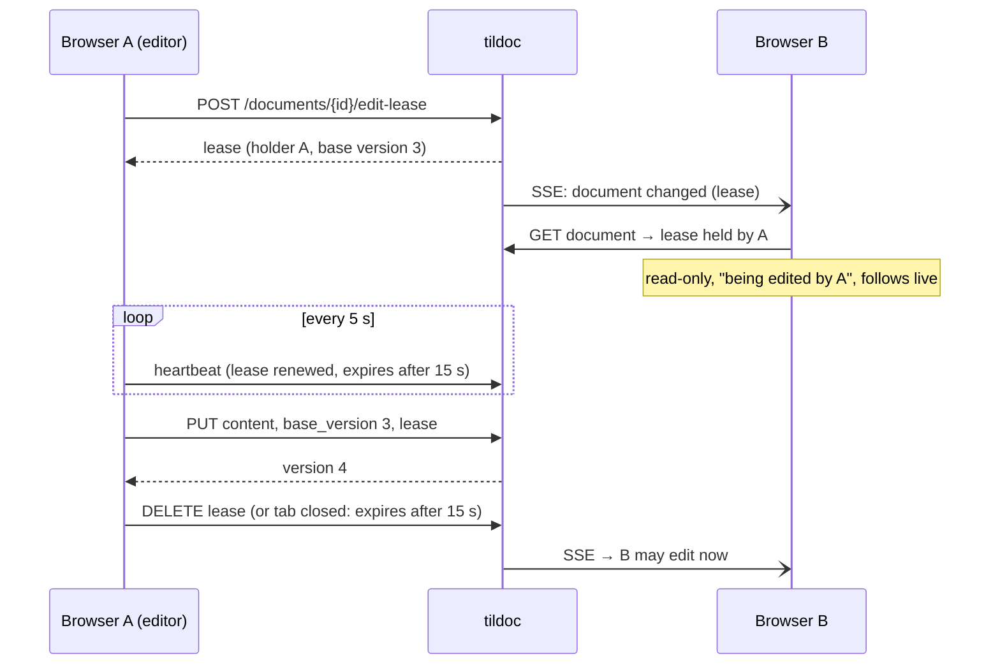

# PLAN.md — tildoc: Self-Hosted Document Management

## Goal

Build **tildoc** — a self-hosted, multi-user document management system inspired
by Immich's architecture and UI philosophy, but focused on documents.

- **Accept every file type.** Supported types (PDF, plain text) get advanced
  services (text extraction, OCR, searchable PDF, full-text search). All other
  files are stored, versioned, listed and downloadable.
- Documents are organized in **Spaces** — personal (user-owned) or **Team**-owned.
- Inside a space, documents live in a **folder hierarchy**. Imported structures
  are preserved as dropped, but can be **remapped** freely without touching files.
- Access via **Web UI** (search-driven details list, customizable columns) and
  **file protocols**: S3-compatible API, WebDAV, SFTP (Dolphin/KDE on Arch Linux
  as primary desktop client).
- Architecturally ready for ML-powered search/classification and additional
  document types without rewriting core components.

**Scope of this build:** Phases 0–6 (incl. OCR). Embeddings/ML classification
remain future work.

---

## Design Principles

### Originals Are Sacred

- Uploaded bytes are never modified. Blobs are **content-addressed** (SHA-256), immutable.
- Overwriting creates a **new version**; previous versions remain.
- Deleting is a **soft delete** (trash with retention, then purge + blob GC).
- Derived artifacts (text, searchable PDF) are keyed by **blob hash** and can be regenerated.

### Never Store Twice (SHA-256 Deduplication)

| Situation | Result |
|-----------|--------|
| Hash unknown | Store blob, create document + link at target path |
| Hash known, live document with this content **in the target space** | No new blob/document — only a new **link** to the existing document |
| Hash known, only **in other spaces** | Blob reused; new document in target space (spaces isolated) |
| Target path already holds a document (overwrite) | New **version** of that document; same hash as current → no-op |

- Copy within a space (WebDAV/SFTP/S3 `CopyObject`, UI) = new link to the same document.
  S3 copy+delete "renames" therefore keep document identity and history.
- Derived artifacts are per blob → deduplicated files are instantly searchable.
- Dedup happens server-side after streaming to a temp file.

> **WARNING (privacy):** no "do you have hash X?" endpoint across spaces/users.
> Responses (timing, ETag) must not differ between new and deduplicated uploads.

### Copy-on-Write for Multi-Linked Documents

Writing a new version **through a link** whose document has more than one live
link forks that link into its own document (history copied, new version appended).
Other links keep the old content — filesystem semantics for users.

### Identity ≠ Link

A document's identity (ID, versions, metadata, derived data) is independent of
where it appears. Moving/renaming documents or subtrees is a metadata operation.
The original import location is recorded as **provenance** and never lost.

### Adapters Over Core

REST, S3, WebDAV and SFTP are thin adapters over a shared **core** (ingest,
documents/folders/links, authz) and a path-based **VFS layer**. No adapter
touches storage or the database directly.

### Processing Pipeline

File type detection is **content-based** (magic bytes, `http.DetectContentType`,
UTF-8 validation). The worker dispatches by MIME type; new types = new processor.

| Category | Detection | Processing |
|----------|-----------|------------|
| Digital PDF | `pdftotext` yields text on every page | Extract text → index |
| Scanned / mixed PDF | Pages without text (form-feed split) | `ocrmypdf --skip-text` → text + derived searchable PDF |
| Text | Valid UTF-8, no NUL | Index content |
| Other | — | `unsupported` (stored, not indexed) |

OCR binary missing → status `ocr_pending`; bulk re-processing available.

---

## Glossary

| Term | Meaning | Protocol mapping |
|------|---------|------------------|
| **Team** | Group of users with roles (owner, admin, member, viewer) | — |
| **Space** | Top-level container, personal or team-owned; isolation boundary | S3 bucket; WebDAV/SFTP top-level folder |
| **Folder** | Node in the folder tree of a space | S3 prefix / dir marker; directory |
| **Document** | Identity: versions, metadata, derived data | — |
| **Link** | Where a document appears: folder + name; 1..N per document | S3 key; file path |
| **Version** | Immutable revision of a document → blob | overwrite creates one |
| **Blob** | Immutable content, SHA-256 addressed (internal) | ETag (MD5) |
| **Import** | Upload batch incl. original drop location (provenance) | per client session |
| **Entry** | Internal: a row of the namespace table `entries` — a Folder or a Link | — |
| **Tag** | Server-wide label attached to documents | S3 object tagging; WebDAV `tildoc:tags` |
| **Collection** | Personal or team list of documents across spaces; grants no access | read-only `/@collections/<name>/` in WebDAV/SFTP |

---

## Core Concepts

- **Teams:** roles viewer (read), member (+write: upload, mkdir, move, version),
  admin (+delete, manage members), owner (+manage team/owners). Multi-team users.
- **Spaces:** unique `slug` (`[a-z0-9-]`, 3–63, S3 bucket rules). Personal space
  auto-created per user. Team spaces created by team admins/owners.
- **Folders:** adjacency list, each space has a root folder. Unique names per
  parent among folders **and** links (enforced in service under parent row lock).
  Deleting a folder soft-deletes all links below (remembering their path), then
  removes the folder rows.
- **Links:** `deleted_path` kept on delete; documents go to trash when their last
  link is deleted. Restore recreates folders as needed. Every document lists all
  its links (UI, REST, WebDAV prop `tildoc:links`, S3 `x-amz-meta-tildoc-links`).
- **Imports / provenance:** `links.original_path` + `import_id`. Rename shortly
  after creation (editor/KIO `.part` save) updates provenance. "Restore original
  structure" per link or per import.
- **Sharing:** deferred. Access purely space-based.

---

## Architecture



- **Single binary** `tildoc` with subcommands: `serve` (REST+WebDAV+S3+SFTP),
  `worker`, `migrate`, `user`.
- **Queue:** Postgres table, `FOR UPDATE SKIP LOCKED`, `LISTEN/NOTIFY` wakeups;
  jobs are enqueued in the same transaction as the ingest.
- **Dependencies:** `pgx/v5`, `golang.org/x/{crypto,net,text,image}`, `pkg/sftp`.
  Everything else stdlib (SigV4, aws-chunked, XML, argon2id via x/crypto, AES-GCM).
- **TLS:** nginx (template `deploy/nginx/`), self-signed cert generated if absent.
  SFTP direct (SSH). nginx must stream (`proxy_request_buffering off`,
  `client_max_body_size 0`), keep `Host` incl. port (`$http_host`) and raw URI.

### Security

- Passwords: argon2id. Sessions: random token, hashed in DB, HttpOnly cookie;
  unsafe methods with cookie auth require `X-Tildoc-CSRF` header.
- Access keys (S3 SigV4, WebDAV/SFTP app passwords): secret AES-256-GCM encrypted
  with master key; scope optional (space, read-only). SSH public keys for SFTP.
- Failed-auth rate limiting per IP + identity.
- File content responses: `X-Content-Type-Options: nosniff`, `CSP: sandbox`
  (except inline PDF), downloads as attachment → no stored XSS on the UI origin.
- Names: NFC-normalized, no `/`, NUL, control chars, `.`/`..`, ≤255 bytes.
- First-run setup endpoint creates the first admin only while no user exists.

---

## Phases

### Phase 0 — Foundation
- [x] git init, `.gitignore`, Go module, layout (`cmd/tildoc`, `internal/*`, `web/`, `deploy/`, `test/`)
- [x] Config from env (`deploy/.env.example` template, `.env` gitignored), slog logging
- [x] Migrations (embedded SQL, own runner)
- [x] Test harness: Postgres in Docker, per-test database from template

### Phase 1 — Data Model & Blob Store
- [x] Schema: users, sessions, access_keys, ssh_keys, teams, team_members, spaces, folders, blobs, documents, document_versions, links, imports, blob_processing, blob_texts, blob_derivatives, jobs, multipart uploads
- [x] Blob store: streaming stage (SHA-256 + MD5 + sniff), atomic commit, open (ReadSeeker + ReaderAt)
- [x] Tests

### Phase 2 — Auth & AuthZ
- [x] Users, argon2id, sessions, access keys (encrypted secrets), SSH keys, rate limiter
- [x] Teams, members, roles, spaces, permission checks
- [x] Tests

### Phase 3 — Core: Ingest, Folders, Links, Trash
- [x] Ingest with dedup / versioning / copy-on-write / provenance; job enqueue
- [x] Folder + link ops (mkdir, move, rename, copy, delete, restore, restore-original), cross-space moves
- [x] Trash purge + blob GC
- [x] VFS layer (path resolution, stat/list/open/put/mkdir/rename/copy/remove)
- [x] Tests

### Phase 4 — REST API & Search
- [x] Setup/login/me, users (admin), keys, teams, spaces, folders, documents, links, uploads (raw streaming PUT with relative path), downloads (original/searchable/version), trash, imports, bulk move, search (tsvector), admin jobs/reprocess
- [x] Integration tests via HTTP

### Phase 4b — Protocol Gateways
- [x] S3: SigV4 (header + presigned), all payload modes (signed, UNSIGNED, aws-chunked signed/unsigned + trailers, CRC32/CRC32C/CRC64NVME/SHA1/SHA256), ListBuckets, Head/GetBucketLocation, CreateBucket (exists → ok), ListObjects V1+V2, Head/Get (Range)/Put/Copy/Delete/DeleteObjects, multipart, dir markers, `x-amz-meta-*`
- [x] WebDAV: `x/net/webdav` on VFS, intercepted MOVE/COPY (versioning-preserving overwrite), Basic auth with app passwords, `tildoc:links` prop
- [x] SFTP: `x/crypto/ssh` + `pkg/sftp` request server on VFS, pubkey + app-password auth, posix-rename
- [x] Integration tests (own SigV4 client validated against AWS test vectors, raw WebDAV, pkg/sftp client)
- [x] Real-client E2E in Docker: aws-cli, rclone (s3, webdav, sftp backends)

### Phase 5 — Web UI
- [x] SvelteKit (Svelte 5, adapter-static, SPA), plain CSS, light/dark
- [x] Setup/login; space/folder tree; details list (sortable, customizable + persisted columns, responsive); search; drag & drop upload preserving folder structure; move/rename/delete/new folder/link; document panel (preview, versions, links, text, status, downloads, new version, reprocess); trash; settings (password, access keys, SSH keys, connection help incl. Dolphin/rclone); teams; admin (users, jobs)
- [x] UI smoke test (Chromium via playwright-core, `test/ui/run.sh`)

### Phase 6 — Worker & OCR
- [x] Job runner (SKIP LOCKED, retries/backoff, stale-lock reclaim, NOTIFY)
- [x] Processors: text, PDF (`pdftotext`), OCR (`ocrmypdf --skip-text`, sidecar text, searchable PDF as derived blob), unsupported
- [x] Periodic: trash purge, blob GC, stale multipart cleanup
- [x] Tests in Docker test image (poppler + ocrmypdf + tesseract deu/eng)

### Phase 7 — Deployment & Docs
- [x] Dockerfile (targets: server, worker incl. OCR tools, web), docker compose (postgres, server, worker, nginx), nginx template + cert generation
- [x] README: setup, Arch/Dolphin client setup (webdavs, sftp, rclone + fuse3 systemd user unit)
- [x] Full-stack smoke test via compose

### Phase 8 — Frontend Rework

**Goal:** a modern, distinctive UI and a document viewer that scales from the
quick side preview up to reading a whole PDF full-window, with page
navigation, zoom, thumbnails and in-document search.

#### Design direction: "light table"

The subject is a personal or team archive of letters, invoices, contracts and
scans. The documents are the content and the UI is the table they lie on.
Only document pages are bright white paper. The chrome sits on a calm, tinted
board, and the viewer puts the pages on a dark stage, like a light box. The
design takes one risk: the **highlighter**. Search hits are marked in
highlighter yellow everywhere: in result snippets, the text layer of a PDF
page, extracted text, and thumbnails of pages that have hits. Everything else
stays quiet.

| Token | Light | Dark | Use |
|-------|-------|------|-----|
| `--board` | `#DCE1DA` | `#1B2024` | app background (grey-green archive board) |
| `--surface` | `#F4F6F2` | `#242B30` | lists, panels, dialogs |
| `--paper` | `#FFFFFF` | `#FFFFFF` | document pages only |
| `--ink` | `#1D2A35` | `#E4E9EC` | text (blue-black ink, not tinted black) |
| `--accent` | `#1F4E79` | `#86AED8` | selection, primary actions (Prussian blue) |
| `--highlight` | `#F2E35B` | `#E2CF45` | search hits (the bold element) |
| `--manila` | `#C49A4A` | `#D3AC5E` | folder icons (functional, not decoration) |
| `--stage` | `#2A3137` | `#15191C` | viewer background |

- **Type:** *Atkinson Hyperlegible Next* everywhere (variable weights,
  tabular figures for sizes and dates). OFL, **self-hosted** under
  `web/static/vendor/fonts` (no font CDN: privacy and CSP). Literata was tried
  for titles and reading text and dropped at the user's request. Scale on 15 px with ratio
  1.2: 12.5 / 15 / 18 / 21.6 / 26. Sentence case throughout, no all-caps labels.
- **Structure means something:** no identical card grid. Settings and admin are
  headed sections divided by rules. Radius has a hierarchy: 4 px for controls,
  8 px for panels, 0 for document pages (paper has square corners). Shadows
  only under paper.
- **Motion:** one orchestrated moment. Opening a document morphs the preview
  page into the viewer (View Transitions API, off under
  `prefers-reduced-motion`). No entrance animations or hover lifts.
- **Copy:** separate labelled fields instead of `PDF · 2 MB · v3` meta strings;
  actions named by outcome ("Move to folder", "Restore version 2"); empty
  states tell the user what to do next ("Drop files here or press U to upload").

#### Shell and file browser

```
┌────────┬──────────────────────────────────────────────┬─────────────────────┐
│ Spaces │  Finance / Invoices / 2026     [search ⌘K]   │  Peek panel         │
│ ▸ Home │ ┌──────────────────────────────────────────┐ │  ┌───────────────┐  │
│ ▾ Team │ │ ▢ Name            Modified   Size  Links │ │  │   page 1      │  │
│   ▸ …  │ │ ▣ invoice-03.pdf  2 Nov      212 KB  2   │◀┼──│   (paper)     │  │
│        │ │ ▢ contract.pdf    28 Oct     1.4 MB  1   │ │  │   scrolls     │  │
│ Trash  │ │ ▢ notes.txt       12 Oct     4 KB    1   │ │  └───────────────┘  │
│ Teams  │ └──────────────────────────────────────────┘ │  Open  Download  ⋯  │
│ ⚙      │   drop zone overlay on drag                  │  Info · Versions …  │
└────────┴──────────────────────────────────────────────┴─────────────────────┘
```

- The left rail holds spaces with the folder tree, then trash, teams and
  settings. It collapses to icons below 1100 px and becomes a drawer on
  mobile.
- File list: a dense table (36 px rows), checkbox multi-select, keyboard
  navigation (↑↓, Enter opens, Space peeks, Del, F2 rename, U upload),
  breadcrumb with drop targets, and a full-area drop overlay showing the
  target folder.
- Peek panel (replaces DocumentPanel):
  - **resizable** from 320 px to 60 % of the window (width saved per browser);
  - preview pages rendered with pdf.js, so the whole PDF already scrolls here;
  - tabs below the preview for Info, Versions, Links and Text.
- ⌘K / Ctrl+K quick search: a palette that jumps to documents and folders.
- Left aligned throughout. Only login and setup are centred, as a single
  column.

#### Document viewer (the core of this phase)

Three levels, one component: **row → peek panel → viewer**. The viewer is its
own route, `/view/[linkId]?page=&q=&v=`:
- it can be bookmarked and deep-linked;
- the browser back button or Esc closes it and returns to the folder, with the
  selection kept.

```
┌──────────────────────────────────────────────────────────────────────────────┐
│ ✕  contract.pdf   ‹ prev  next ›     ◂ 3 / 12 ▸   − 110 % +  Fit ▾   Find  ⓘ │
├──────┬───────────────────────────────────────────────────────┬───────────────┤
│ ▭ 1  │                                                       │ Info drawer   │
│ ▭ 2  │            ┌──────────────────────────┐               │ Original /    │
│ ▣ 3 ●│            │                          │  dark stage   │ Searchable    │
│ ▭ 4  │            │   page 3   ▇▇ highlight  │               │ Versions      │
│ ▭ 5 ●│            │                          │               │ Links (2)     │
│ …    │            └──────────────────────────┘               │ Text          │
│thumbs│            continuous scroll, lazy pages              │ Download      │
└──────┴───────────────────────────────────────────────────────┴───────────────┘
  ● = page contains search hits
```

- **PDF:**
  - pages scroll continuously and only the visible pages ±2 are rendered;
    canvases are released again, so large PDFs stay light;
  - a text layer allows selecting and copying text;
  - **Find** (Ctrl+F inside the viewer) highlights hits and steps through them
    with Enter / Shift+Enter;
  - thumbnails, with markers on pages that have hits;
  - zoom: fit width, fit page, 50–400 %, Ctrl+wheel and pinch;
  - view-only rotation;
  - page input; Original vs Searchable (OCR) toggle; version switcher.
- **Images:** fit or 1:1, zoom and pan, the same stage.
- **Text:** a reading column ≤ 75ch, monospace for code and
  structured types, find with highlights.
- **Other types:** a large file sheet with type, size, versions and links, plus
  Download.
- **Navigation:** `[` / `]` move to the previous or next document in the
  folder. Esc closes.
- **Arriving from search:** the server returns the **page of the first hit**
  (pdftotext keeps `\f` page breaks), so the viewer opens on that page with the
  terms highlighted.
- **Mobile:** full screen; thumbnails and the info drawer become bottom sheets.
- **Print and "open in browser":** download only. See the security note below.

#### Other screens

Search becomes a result list with highlighted snippets, page numbers, a
space/folder/type filter and a row click into the viewer. Trash, Spaces,
Teams, Settings (access keys, SSH keys, connection help), Admin, Login and
Setup are restyled with the new tokens, copy and section structure. Toasts,
modals and the folder picker are redone.

#### Technical notes

- **Dependency:** `pdfjs-dist` 6.4 (Mozilla, Apache-2.0), pinned. It is the only new
  runtime dependency. It is loaded lazily, so the worker loads only when a PDF
  is shown. PDF scripting and XFA are off (the QuickJS engine is not even
  shipped); the CSP forbids JS eval. Links inside PDFs open with
  `noopener,noreferrer` after a confirm prompt, internal links jump to the page.
  Assets (cmaps, standard fonts, WASM decoders, fonts) are copied from the
  pinned npm packages by `web/scripts/vendor-assets.mjs` into the gitignored
  `web/static/vendor/` before `dev` and `build`.
- **Viewer preference:** `users.prefs` (jsonb, `pdf_viewer`: `pdfjs` default |
  `native`), set in *Settings and access → Opening documents*. `native` shows
  PDFs in an iframe with the browser's viewer; only for users with that
  preference does `?inline=1&viewer=native` drop the sandbox CSP (checked
  server-side).
- **CSP (UI):**
  - add `worker-src 'self'`;
  - add `'wasm-unsafe-eval'` to `script-src` (pdf.js v5 decodes
    JPX/JBIG2 images via WASM);
  - `script-src` stays hash-based.
- **Security fix:** inline PDF responses get `CSP: sandbox` too. Today they are
  the one inline type served without it. Since pdf.js fetches the bytes and
  renders them to canvas on the UI origin, the browser's own PDF viewer is no
  longer needed. Entry for HISTORY.md.
- **Server additions:**
  - search results include `page`;
  - a `pages` count in the document DTO (already in `blob_processing`);
  - no new endpoints; byte ranges already work, so pdf.js streams large PDFs.
- **No UI libraries:** components stay in plain Svelte 5 and plain CSS, with
  tokens in `app.css`.

#### Steps

- [x] 8.1 Tokens, self-hosted fonts, base controls (buttons, inputs, tables, tabs, dialogs, toasts), light and dark themes
- [x] 8.2 Shell: rail with folder tree, header with breadcrumb and quick search, responsive drawer
- [x] 8.3 File browser: table, keyboard navigation, selection, drop overlay, empty states
- [x] 8.4 Viewer core: pdf.js loader, lazy page virtualisation, text layer, zoom/fit, page navigation
- [x] 8.5 Viewer features: thumbnails, find with highlights, OCR/version toggle, info drawer, prev/next, image and text modes, mobile sheets
- [x] 8.6 Peek panel on the viewer component (resizable), view-transition open
- [x] 8.7 Server: search hit page, `pages` in DTO, CSP update, sandbox for inline PDF + HISTORY.md
- [x] 8.8 Search, trash, spaces, teams, settings, admin, login/setup restyle
- [x] 8.9 Tests: extend `test/ui/smoke.mjs` (multi-page fixture; open viewer, page jump, find count, OCR toggle, Esc restores selection, mobile, dark, **no CSP/console errors**); Go tests for hit page; screenshot review pass; commit "Phase 8"
- [x] 8.10 Follow-up: one typeface, hints below inputs, full-width subpages, row click shows the preview and the file name opens the viewer

### Phase 9 — Data Model Cleanup

**Goal:** move invariants from Go into the schema, remove redundancy, fold
everything into `0001_init.sql` (development mode, dev databases are
recreated).

- [x] 9.1 Space integrity in the DB: `links.space_id` plus composite FKs
  `(folder_id, space_id) → folders(id, space_id)` and
  `(document_id, space_id) → documents(id, space_id)`; `folders.parent_id`
  likewise `(parent_id, space_id)`. A link can then never point across spaces.
- [x] 9.2 One namespace per folder: replace `folders` + `links` placement by a
  single `entries` table (`id, space_id, parent_id, name, kind folder|link,
  document_id`) with `UNIQUE (parent_id, name)`, so a file and a folder can
  never share a name (today only the Go lock in `child()` prevents it).
- [x] 9.3 No duplicated document head: drop `documents.current_sha256`; keep
  `current_version` with a deferrable FK `(id, current_version) →
  document_versions`. The content hash then lives only in `document_versions`.
- [x] 9.4 Trash state in one place: a document is in the trash exactly when it
  has no live link. Keep `documents.deleted_at` (purge clock) but enforce
  the invariant with a constraint trigger, or derive it.
- [x] 9.5 Value rules as CHECKs: names (non-empty, no `/`, no control chars,
  ≤ 255 bytes), slug and username patterns, closed value sets for
  `imports.protocol`, `document_versions.source`, `blob_texts.method`,
  `blob_processing.kind`, `blob_derivatives.kind`, `jobs.kind`.
- [x] 9.6 Preferences as typed columns: `users.pdf_viewer text NOT NULL DEFAULT
  'pdfjs' CHECK (...)` instead of the `prefs` jsonb (folded into 0001,
  0002 removed).
- [x] 9.7 Tests: schema-level tests that try to violate each invariant directly
  in SQL; full suites green.
- [x] 9.8 Dedup on cross-space moves: moving a document into a space that
  already holds the same content currently leaves two documents with equal
  content there (violates decision 10). Merge rule needed (see open questions).
- [x] 9.9 (accepted, decision 23) Per-document processing view: `blob_processing` is shared by all
  spaces, so a second uploader of the same bytes sees "Indexed"/OCR done at
  once (reveals that the file existed on the server), and "Extract text
  again" by one user resets the status for everybody.

Verified by tests (`internal/core/storage_test.go`):
- Moving between spaces only remaps references: same document id, link id and
  history; blob files on disk untouched (inode + mtime), no new blob rows, no
  reprocessing; access (incl. search and text) follows the new space; multi-
  placed documents split copy-on-write; folder trees move the same way.
- Content and its text index are stored once per server; search (text, names,
  space/folder filters), document/content/text access, links to foreign
  documents and trash are all limited to readable spaces, also for server
  admins; purging one owner keeps the bytes for the other, GC removes them
  once unreferenced.

### Phase 10 — Tags and Collections

- [x] 10.1 Core: tags (create by anyone, rename/merge/delete by admins, per-caller counts), document tags, S3-style replace by names
- [x] 10.2 Core: collections (personal/team, view/edit/manage by role, tag rule, items filtered by readable spaces), search filters `tag`/`collection`
- [x] 10.3 Protocols: read-only `/@collections/<name>/` in WebDAV/SFTP (name clashes "name (2).ext", team suffix for duplicate names), S3 object tagging, WebDAV `tildoc:tags`
- [x] 10.4 REST: `/api/tags`, `/api/documents/{id}/tags`, `/api/collections`
- [x] 10.5 UI: tags in details and file lists, collections in the rail, collection page, "Add to collection", viewer prev/next within a collection, tag/collection search filters, tag administration
- [x] 10.6 Tests: core (permissions, isolation, tag rule, moves/trash), vfs read-only, e2e (aws tagging, rclone WebDAV/SFTP collections), UI smoke (32 steps)

**Tags** (central vocabulary per server instance):



- Tags attach to the **document** (all its places show them; forks copy them).
- Vocabulary managed centrally (admins create/rename/merge/delete); users
  with write access to a space assign existing tags to its documents.
- Search: `tag:steuer-2025` filter, tag facets, tag column in file lists.
- Protocols: S3 object tagging (`?tagging`), WebDAV property `tildoc:tags`.

**Collections** (virtual grouping across spaces):



- References **documents**, not paths: moving or renaming a file keeps it in
  the collection; deleting removes it.
- A collection never grants access: each viewer sees only the items in
  spaces they can read (a personal + team "Steuer 2025" collection shows team
  members only the team items).
- Optional rule (smart collection), e.g. all documents tagged `steuer-2025`.
- UI: "Collections" in the rail, "Add to collection" on files, viewer
  prev/next within a collection. Protocol view (read-only
  `/@collections/<name>/` in WebDAV/SFTP) later.

### Phase 11 — Export, Import, Backup

**Goal:** get data out of and into tildoc in three forms, with one import
path that behaves like every other way of adding files. Everything is
identified by UUIDs; names and short names are only labels.

| Form | For | Contents | Scope | Trash |
|------|-----|----------|-------|-------|
| **Files export** | People, other programs | ZIP of the current files in the shown folder structure with the shown names | space, folder, collection | no |
| **Bundle** | Another tildoc server | all versions, all derived variants (text, OCR PDFs), places, original paths, tags, collections | space, collection | no |
| **Server backup** | Operators | bundle of the whole server incl. users, teams, keys; full or differential | whole instance | yes |



#### 11.0 UUIDs everywhere

- All entities already use UUIDs (users, teams, spaces, entries, documents,
  tags, collections, imports). Exceptions stay deliberate: S3 access key ids
  (`DK…` format required by S3 clients), session token hashes (secrets),
  blobs (content address = SHA-256).
- Switch the remaining technical ids to UUIDs: `jobs.id` (bigserial) and
  `multipart_uploads.id` (random text; the S3 UploadId becomes the UUID).
- Defaults become `uuidv7()` (PostgreSQL 18): time ordered, better index
  locality, still opaque.
- Bundles and backups reference everything by UUID. Space short names
  (slugs) remain only the protocol label (S3 bucket, WebDAV/SFTP folder) and
  can be changed freely.

#### Files export (ZIP)

- Streamed directly into the download (no temporary copy), `archive/zip`
  from the stdlib (UTF-8 names, ZIP64).
- Exactly what UI and WebDAV show: folder tree and names of a space or
  folder; a collection flat with the names of `/@collections/<name>/`.
  Current versions only, no trash, empty folders included.
- REST `GET /api/spaces/{id}/export`, `/api/folders/{id}/export`,
  `/api/collections/{id}/export`; UI "Export as ZIP"; CLI `tildoc export`.
- Permission: read access (decision 26).

#### Bundle (tildoc to tildoc)

- Format `tildoc-bundle` v1 (`docs/bundle-format.md`): tar stream,
  `manifest.json` first, then `blobs/<sha256>` (each content once).
- Manifest: format version, kind (space | collection | server), source
  instance UUID, folders, documents with **all versions** and the **full
  derivative tree** (text, OCR PDFs, later image-only variants; see Phase 12),
  places (path, original path, created), tags, collections. Every object
  carries its UUID; users referenced by UUID + username (no credentials,
  except in server backups).
- Consistent snapshot (REPEATABLE READ); blob GC waits while an export runs.

#### Import (one path, same rules as uploads)

- Every blob goes through the normal ingest: `Stage` → SHA-256 checked
  against the manifest → `Commit` → `registerBlob`. Bytes already on the
  server are not stored again; derived data from the bundle is taken over
  (no OCR rerun).
- Documents and places follow the upload/move rules: identical content in
  the target space becomes another place of that document and the
  histories merge (decision 22); taken names get " (imported)".
- **Remapping (users):** a user imports a space bundle as a **new space**
  (new UUIDs, own name and short name, the importer or one of their teams as
  owner) or **into an existing space/folder** they can write. Tags matched by
  name (created if missing), collections become the importer's personal
  collections (or a team's, if the importer manages it).
- Hostile input is expected: version check, name/path validation (no
  traversal, `valid_name`), size and count limits, hash of every blob,
  unknown fields rejected; metadata applied in one transaction (all or
  nothing; orphan blobs are collected by GC).
- Runs as a job (upload to staging, then apply) with progress; REST
  `POST /api/imports/bundle`, UI "Import space" (Spaces page) and
  "Import into this folder"; CLI `tildoc import`.
- A plain ZIP (e.g. a files export) can be imported into a folder through
  the same upload path.

#### Server backup: full and differential



- **Full:** complete metadata snapshot + every referenced blob.
- **Differential:** complete metadata snapshot (small) + only the blobs not
  contained in its base full backup. Restore needs exactly two files: the
  full backup and the newest differential. (Blobs are immutable and content
  addressed, so "not in the base" is an exact set difference, no change
  tracking needed.)
- Includes trash, all versions, derived data, users (password hashes),
  teams, memberships, spaces, tags, collections, SSH keys, access keys
  (secrets stay encrypted; `TILDOC_MASTER_KEY` is not in the backup).
  Excludes sessions, jobs, multipart uploads.
- Stored only on the server in `TILDOC_BACKUP_DIR` (decision 27); whoever
  has file system access copies them. Administration shows the list
  (mode, base, date, size, status), starts backups and deletes them;
  retention keeps the last N full backups with their differentials (a full
  backup cannot be deleted while differentials depend on it).
- Schema: `backups(id uuid, mode full|differential, base_id → backups,
  status, started_at, finished_at, file, size, blob_count, error)` and
  `backup_blobs(backup_id, sha256)` for full backups (the set the
  differentials are computed against).
- CLI: `tildoc backup full|differential` (cron / systemd timer),
  `tildoc backup verify <file>`, `tildoc restore <full> [<differential>]`
  into an empty instance only, UUIDs preserved (decision 28). Logical
  format, independent of the schema version.

#### Encryption (later, prepared now)

- Writer/reader chains with an optional encryption stage; format `age`
  (passphrase or public key) when implemented (decision 29).

#### Steps

- [x] 11.0 UUIDs: `jobs.id`, `multipart_uploads.id` as UUID, `uuidv7()` defaults
- [x] 11.1 Export foundation: writer chain with encryption stage, snapshot reader, GC guard
- [x] 11.2 Files export (ZIP): space, folder, collection; REST, UI, CLI
- [x] 11.3 Bundle format v1 spec + exporter (space, collection) incl. all versions and derivative tree
- [x] 11.4 Bundle importer: validation, blob ingest with dedup, documents/history/places/tags/collections, remap to new or existing space, atomic apply, job + progress; REST, UI, CLI
- [x] 11.5 ZIP import into a folder (upload path)
- [x] 11.6 Server backup full/differential: schema, job, backup dir, retention, Administration UI, CLI backup/verify/restore
- [x] 11.7 Tests: round trips between two test instances (files, bundle, full + differential restore), dedup/merge on import, remap, permissions, hostile bundles, ZIP checked with `unzip`/`bsdtar`, UI smoke
- [x] 11.8 Docs: README (export, import, backup, restore), bundle format

### Phase 12 — OCR variants

- A document version can have a **tree of derived variants**:
  - original without text layer → our OCR as searchable PDF;
  - original with an existing (foreign) OCR layer → an image-only variant
    split off the original → our OCR on it.
- Server administration chooses which OCR is preferred for search, text
  view and the viewer ("existing layer" vs "tildoc OCR"), per installation.
- The document details visualize the variant tree (original → image-only →
  OCR), with engine, language and date, and allow viewing/downloading each.
- Data model: `blob_derivatives` already chains (source → derived); it gets
  kinds `image_only_pdf` and `searchable_pdf` with engine metadata.
- Exports (bundles, backups) carry the whole tree (Phase 11).

- [x] 12.1 Schema: `blob_derivatives.input_sha256/engine/meta`, kinds `image_only_pdf`, `pdf-ocred`; `instance_settings.ocr_preference`; SQL `text_sha()` picks the text for search and the text view
- [x] 12.2 Worker: detect foreign OCR (every page a full-page image with text: `pdfinfo` + `pdfimages`), image-only variant via Ghostscript `-dFILTERTEXT` (images passed through, no downsampling), own OCR via ocrmypdf; switch `TILDOC_OCR_REDO_FOREIGN`
- [x] 12.3 API/UI: variants tree in document details (view/download per variant, "used for search"), viewer switch "Existing OCR / tildoc OCR", OCR preference in Administration
- [x] 12.4 Tests: worker test in the OCR image, compose E2E with the real worker image

### Phase 13 — Permission model

- Today: personal spaces (owner) and team spaces (team roles owner, admin,
  member, viewer) map to one level read < write < delete < manage, computed
  in one place (`requirePerm`).
- Proposed: **capabilities** instead of levels (`view`, `download`,
  `export`, `write`, `delete`, `manage`, `share`), roles as named capability
  sets, and **space grants** (`space_grants(space_id, user_id | team_id,
  role)`) so a space can be shared with single people or several teams.
- Not needed for Phase 11: export uses read access (decision 26), and the
  check lives in the one permission function, so the capability model can
  replace it later without touching the export code.

- [x] 13.1 Capabilities (`view, download, export, write, delete, share, manage`) in `internal/core/permissions.go`; roles are capability sets; access keys (scope, read-only) restrict them; spaces report `caps`
- [x] 13.2 `space_grants` (user or team, role viewer/member/admin) and SQL `space_role()`: strongest of ownership, owning-team role, direct grant, team grant capped by the member's team role
- [x] 13.3 Sharing API and dialog; nobody grants more than their own role; owners only through ownership
- [x] 13.4 Tests: sharing, team capping, revoke, read-only keys, collections and search follow the grants

### Phase 14 — Encryption of exports and backups (`age`)

**Goal:** exports (ZIP, bundle) and server backups can be encrypted with
[age](https://age-encryption.org/v1); imports, `verify` and `restore`
decrypt them. Files stay readable with the standard `age` CLI
(`age -d -i key.txt backup.tildoc.age > backup.tildoc`).



- **Library:** `filippo.io/age` (reference implementation; its only
  dependencies are `golang.org/x/crypto`/`x/sys`, already in use, plus
  `filippo.io/edwards25519`). Own crypto is not an option.
- **Core:** `internal/core/agecrypt.go` implements `Sealer`/`Opener`:
  `RecipientSealer` (public keys), `PassphraseSealer`, `IdentityOpener`
  (identity file and/or passphrase). `open()` detects the age header
  (`age-encryption.org/v1`), so plain and encrypted input share one path;
  an encrypted file without a key fails with a clear error.
- **Backups:** encrypted to the public keys in
  `TILDOC_BACKUP_RECIPIENTS` (comma-separated) or
  `TILDOC_BACKUP_RECIPIENTS_FILE`. The server never holds a private key,
  so it can write backups but not read them. Files get `.age`;
  `backups.encrypted` + recipient fingerprints are recorded and shown in
  Administration. `tildoc backup verify|restore --identity key.txt`.
  Differentials still work (computed from `backup_blobs`, not the files).
- **Exports (UI/REST):** optional passphrase. The browser downloads via
  GET (no CSRF header possible), so: `POST …/export` with the passphrase
  (JSON, CSRF header) → single-use download ticket (random 256-bit, 60 s,
  bound to the session, in memory) → `GET /api/exports/{ticket}` streams
  the encrypted file. The passphrase never appears in a URL or log.
- **Imports (UI/REST):** encrypted bundles/ZIPs are decrypted while the
  upload streams into the staging file; the passphrase comes in a request
  header and is never stored (the background job only sees plaintext,
  like any upload). Only passphrases in the browser — private keys are not
  uploaded to the server.
- **CLI:** `export --passphrase-file f | --recipient age1… | --recipients-file f`,
  `import --identity f | --passphrase-file f`; `TILDOC_PASSPHRASE` as
  alternative; never as a plain argument (shell history, `ps`).
- **Security limits:** scrypt is memory-hard (work factor 18 ≈ 256 MiB,
  ~1 s): server-side passphrase operations run through a semaphore
  (2 concurrent) and decryption caps the work factor at 18 (bundles are
  untrusted: a header with factor 22 would cost 4 GiB). Minimum
  passphrase length 12. Ciphertext is authenticated per 64 KiB chunk;
  truncation is detected at EOF, and imports only apply after the full
  stream verified.

#### Steps

- [ ] 14.1 `filippo.io/age`; `agecrypt.go` (sealers, opener, header detection, work-factor cap, semaphore)
- [ ] 14.2 Backups: recipients config, `.age` files, `backups.encrypted`/`recipients`, verify/restore with identity, Administration shows state + warning when unencrypted
- [ ] 14.3 Exports: ticket endpoint, passphrase field in the export menu (ZIP and bundle)
- [ ] 14.4 Imports: passphrase in ImportDialog, decrypt while staging, clear error for missing/wrong key
- [ ] 14.5 CLI flags for export/import/backup/restore
- [ ] 14.6 Tests: round trips (recipient, passphrase, both decrypted with the `age` CLI in e2e), wrong key, truncated/tampered file, oversized work factor, ticket single-use/expiry/other session, UI smoke (encrypted export + import)
- [ ] 14.7 Docs: README (key generation, restore), bundle-format (encryption layer), HISTORY.md

#### Open questions

1. Backups without `TILDOC_BACKUP_RECIPIENTS`: (a) allowed with a warning
   in Administration and logs (recommended for dev), or (b) refused?
2. Should exports also support encrypting to a user's **public key** stored
   in their profile (no shared passphrase)? Proposed: later.
3. Post-quantum: accept hybrid ML-KEM recipients (`age1pq…`) besides
   X25519? Proposed: yes, `age.ParseRecipients` handles both; README
   recommends generating PQ keys (`age-keygen -pq`).

### Phase 15 — UI performance and live updates

**Goal:** the UI loads less, waits less and shows changes made elsewhere
(worker, WebDAV/S3/SFTP, other people) without polling or reloading.



- **Events:** triggers on `blob_processing`, `entries`, `documents`,
  `document_versions`, `document_tags`, `transfers` send small payloads
  (`{"t":"space","id":…}`, `{"t":"blob","sha":…}`, `{"t":"transfer",…}`);
  identical payloads in one transaction are delivered once, so bulk uploads
  do not flood. The hub resolves blobs to `(space, document)` and sends each
  subscriber only events of spaces it can read (cached 30 s) and its own
  transfers. Connections live at most 5 min (re-auth + fresh grants on
  reconnect), heartbeat 25 s, max 8 per user. After a reconnect the UI
  refreshes everything once (missed events).
- **Transport:** JSON GET responses get a strong `ETag` (SHA-256 of the body)
  and `304` on `If-None-Match`, gzip when accepted and > 1 KiB; they stay
  `no-store` (no authenticated data in the browser's disk cache): the
  in-memory client cache sends `If-None-Match` itself. Static UI is
  precompressed at build (`.br`, `.gz`); Go and nginx (`gzip_static`) serve
  the variants, nginx gzips proxied JSON too.
- **Client cache:** stale-while-revalidate for folders, collections,
  documents (max 100 entries): back-navigation renders instantly, then
  revalidates (mostly a `304`).
- **Fewer round trips:** session data (`/me`, `/spaces`, `/collections`,
  `/info`) in parallel; `GET /files/{id}?include=document`; the folder
  tree only fetches the space of the current folder.
- **In-document search:** pages are pre-selected with the server's
  extracted text (pages separated by form feeds); pdf.js only extracts text
  of candidate pages. Falls back to a full scan when the page count does not
  match or no text exists.
- **Large folders:** the file table renders only visible rows (> 200 rows).
  Server-side paging and sorting: later.
- **Preloading:** viewer code on hover of a file name, pdf.js when the peek
  panel opens.

#### Steps

- [x] 15.1 Schema: notify triggers; `core.EventHub` (LISTEN with reconnect, blob → documents, permission filter); `GET /api/events` (SSE)
- [x] 15.2 JSON middleware: ETag/304, gzip; `include=document`
- [x] 15.3 Static compression: adapter `precompress`, Go serves `.br`/`.gz`, nginx `gzip_static` + JSON gzip
- [x] 15.4 UI: events client (polling fallback, resync), cache with ETag, parallel session load, viewer start, folder tree
- [x] 15.5 UI: find via server text, virtual file table, preloading
- [x] 15.6 Tests: events (filtering, dedup, transfer owner), ETag/gzip, compression headers, UI smoke (live status without polling, large folder, find), compose (SSE through nginx)
- [x] 15.7 Docs: README (events, nginx), AGENTS.md

### Phase 16 — History graph: versions and variants in one tree

**Goal:** the document details show one graph instead of the separate
"Versions" list and "Content variants" tree. Versions form the main line,
derived variants branch off diagonally (like `git log --graph`), and a
version that continues from a variant (or restores an old version) joins
back from that node. Drawn with a small Svelte SVG component, no library.

Example: v1 is a scan with foreign OCR, v2 came via WebDAV, v3 is tildoc's
OCR PDF of v1 uploaded again, v4 restores v2.



Intended drawing (oldest at the top, the original is the starting point):

```
●  v1  scan.pdf          12 Mar, web          [view] [⤓]
│╲
│ ○  image only          Ghostscript          [view] [⤓]
│ │╲
│ │ ◉  tildoc OCR       deu+eng, search      [view] [⤓]
│ │ │
●  ┊ │  v2               14 Mar, WebDAV       [view] [restore] [⤓]
│  │ │
● ─┊─╯  v3  continued from tildoc OCR of v1
│  ┊
●──╯    v4  current, restored from v2
```

**Data (no new tables):**
- Per version its variant tree (`blob_derivatives` by the version's blob;
  today only the current version's variants are returned).
- "Continued from" is derived, not stored: a version whose content equals
  a variant of an earlier version (same SHA-256) continues from that
  variant; equal to an earlier version means re-upload of it.
- "Restored from" today lives in `document_versions.meta` as text; becomes a
  real column `restored_from integer` with a foreign key to the same
  document's version (decision pending, see questions).

**Layout:** lane 0 is the main line of versions; each variant chain gets the
next free lane, branching diagonally from its input; a lane is held until
its last use (a later version continuing from it) and then reused. Rows:
each node one row, variants directly below their version. Nodes: filled =
version, hollow = variant, ring = current / being viewed, marker = used for
search. Labels and actions (view, download, restore) are HTML rows next to
the SVG (keyboard and screen reader friendly); the SVG is decoration
(`aria-hidden`), the list carries the meaning.

#### Steps

- [x] 16.1 Core/API: variants per version, `continued_from` (version + variant kind) and `restored_from` per version in the document JSON
- [x] 16.2 Schema (if confirmed): `document_versions.restored_from` column + FK, restore writes it, bundles carry it (bundle format v2 or optional field)
- [x] 16.3 UI: `lib/history.js` (lane layout, pure function, unit-testable), `HistoryGraph.svelte` (SVG + rows), replaces the Versions tab and the variants tree; compact mode for the peek panel
- [x] 16.4 Worker (if confirmed): content that is already a tildoc variant is not OCRed again
- [x] 16.5 Tests: layout function (lanes, reuse, merge back, restore), API, UI smoke (graph shows variants and versions, open a variant of an old version)
- [x] 16.6 Docs: README (history), bundle format if changed
- [x] 16.7 ~~Viewer toolbar: the graph horizontally~~ removed again (2026-11-09): the history stays in the document properties (History tab), also in the viewer's drawer
- [x] 16.8 Selecting or opening a file starts at its latest node (newest version, newest variant); horizontal strip widened and flattened

Answers (2026-11-08): oldest at the top; one "History" tab; `restored_from`
as a column with FK; tildoc's own OCR output is not OCRed again (kind
`pdf-tildoc-ocr`). Decision 36.

Open questions: see below.

### Phase 17 — Text editor

**Goal:** text files (`text/*`, up to 5 MB) open directly in an editor in the
full viewer; the preview stays read-only. Saving is confirmed in a review of
the changes and creates a new version. Only one person edits a document at a
time (edit lease, live via SSE).

**Editor:** CodeMirror 6, lazy-loaded like pdf.js (packages `@codemirror/state`,
`view`, `commands`, `search`, `language`, `merge`, and language modules for
Markdown, JSON, XML/HTML, YAML, CSS, JavaScript; all from the CodeMirror
project, MIT). Search/replace (Ctrl+F/H), move lines (Alt+↑/↓), duplicate
(Shift+Alt+↓), undo history, line numbers, syntax highlighting by type and
extension; theme from the design tokens (light/dark).



**Concurrent changes:** the lease covers editors in the UI (other users and
other tabs of the same user). WebDAV, SFTP and S3 clients cannot take part in
it and are not blocked (decision 37). The last save wins: if a version
arrived meanwhile through another channel, the review warns and shows the
difference against that newer version; saving makes the editor's text the
current version, the other one stays in the history.

**Details:**
- Lease in the database (`edit_leases`: document, user, client id, base
  version, expires_at), one per document, renewed by heartbeat, expires 15 s
  after the last one; a trigger sends the change over the existing event
  stream. The holder can take over its own lease from another tab after a
  confirmation.
- Open read-only (with the reason) when: no write permission, larger than
  5 MB, not valid UTF-8, or someone else holds the lease. Line endings (LF /
  CRLF) and a UTF-8 BOM are kept as they were.
- Save: Ctrl+S or "Save" → review dialog with the diff (unified, against the
  version opened) → "Save as version N" → confirmation toast; leaving with
  unsaved changes asks first.

#### Steps

- [x] 17.1 Schema + core: `edit_leases` (acquire, heartbeat, release, expiry), event trigger; save requires the lease, version source `editor`; limits (5 MB, UTF-8)
- [x] 17.2 API: lease endpoints, `PUT /api/documents/{id}/text` (lease), lease state in the document JSON
- [x] 17.3 UI: `TextEditor.svelte` (CodeMirror lazy, theme, languages, keys), editor mode in the viewer for text files, read-only states with reason, live lease updates
- [x] 17.4 UI: review dialog with diff (`@codemirror/merge`), warning when a version arrived meanwhile, unsaved-changes guard
- [x] 17.5 Tests: core (lease exclusivity, expiry, takeover, base version conflict, size/encoding limits), API, UI smoke (edit, Alt+↑, search/replace, review + save → version, second user read-only then free after release, conflict via WebDAV write), compose (lease through nginx)
- [x] 17.6 Docs: README, AGENTS.md

Answers (2026-11-09): WebDAV/SFTP/S3 are not blocked, the last save wins;
the review before saving is always shown. Decision 37.

---

### Phase 18 — Name, licence, icon

Goal: the project is called **tildoc** (Go module `github.com/tildoc/tildoc`),
licensed AGPL-3.0-only, with its own icon.

- [x] 18.1 Rename everywhere: module path and imports, `cmd/tildoc`, `TILDOC_*`
  env vars, Docker images/user/compose project, DB names, `pg_notify` channel,
  cookie, localStorage keys, bundle format `tildoc-bundle` (`.tildoc`), OCR
  kind `pdf-tildoc-ocr`, WebDAV/S3 metadata names, nginx files.
- [x] 18.2 `LICENSE` (AGPL-3.0-only), `license` in `web/package.json`, README
  section; AGENTS.md: new dependencies need a permissive licence.
- [x] 18.3 Icon: master `docs/assets/tildoc.png`; `web/static/icon-{32,64,180}.png`
  (cropped, generated with ffmpeg) as favicon, apple-touch icon and brand mark.

## Open Topics

Collected 2026-11-08; each becomes a phase or step when picked up.

**Planned, not started**

- [ ] **Phase 14 — `age` encryption** of exports and backups (plan above).
  Open questions: backups without recipients (warn vs. refuse), exports
  encrypted to a public key stored in the user's profile, post-quantum
  recipients (`age1pq…`).

**Scaling**

- [ ] Server-side paging and sorting for folder listings (today the API
  returns all rows; the UI only renders the visible window).
- [ ] Bundle and backup manifests are built in memory; stream them for very
  large installations.
- [ ] Search and collection pages: paging works, but the result pages are
  not live-updated (snapshot on load).

**Live updates**

- [ ] Collection membership changed by someone else (team collections,
  `collection_items`) is not pushed; needs a trigger + event type.
- [ ] Sidebar collection counts and the spaces list do not follow events
  (new shares, renamed spaces appear after a reload).
- [ ] Revoked access: a subscriber may receive ids of the space for up to
  30 s (readable-space cache). Option: invalidate on `space_grants` /
  `team_members` changes via an event.
- [ ] Admin backup list still polls (2 s) while a backup runs; move to an
  event like transfers.

**Viewer and search**

- [ ] In-document find skips pages whose server text lacks a term that
  pdf.js would find (different extraction); consider per-page text from
  pdf.js cached server-side, or a fallback scan when nothing is found.
- [ ] Server-assisted find only for the current version; older versions
  scan all pages (needs `GET /documents/{id}/text?version=`).

## Decisions

| # | Topic | Decision |
|---|-------|----------|
| 1 | File types | Accept all; advanced services for supported types |
| 2 | Structure | Folder tree preserved as dropped; remappable; provenance kept |
| 3 | Overwrite | New version |
| 4 | Sharing | Deferred; space-based access only |
| 5 | S3 implementation | Own, Go stdlib |
| 6 | Deduplication | SHA-256; known file in space → new link only |
| 7 | Desktop protocols | WebDAV **and** SFTP |
| 8 | Libraries | `golang.org/x/*`, `pkg/sftp`, `pgx/v5` |
| 9 | TLS | nginx in front of HTTP adapters |
| 10 | Duplicate in same space | One document, multiple links |
| 11 | Delete link | Only that link; document to trash with last link; all links visible |
| 12 | Terminology | Space, Team, Folder, Document, Link (Blob internal) |
| 13 | PDF text | poppler `pdftotext` |
| 14 | Queue | Postgres (replaces Redis) |
| 15 | Scope | Phases 0–6 incl. OCR |
| 16 | Repo | git, one commit per phase; tests via Docker; no AWS SDK |
| 17 | Write via multi-linked doc | Copy-on-write fork |
| 18 | PDF viewer | pdf.js (`pdfjs-dist`) by default; browser viewer selectable per user |
| 19 | UI font | Atkinson Hyperlegible Next only, self-hosted |
| 20 | Access key secrets | 40 alphanumeric chars (no leading `-` that CLIs parse as a flag) |
| 21 | Namespace | one `entries` table (folders + file placements), one name per folder |
| 22 | Move into space with same content | merge into existing document, histories merged chronologically |
| 23 | Shared processing state | accepted side channel (dedup reveals prior existence of identical bytes) |
| 24 | Tags | central vocabulary, users create, admins rename/merge/delete; attached to documents |
| 25 | Collections | personal or team-owned, reference documents, never grant access, read-only in WebDAV/SFTP |
| 26 | Export permission | anyone with read access (finer model: Phase 13) |
| 27 | Server backups | full and differential, kept on the server only (no download in the UI) |
| 28 | Restore | whole server only via CLI into an empty instance; users import space bundles and remap them to new or existing spaces |
| 29 | Export encryption (later) | `age` |
| 30 | Trash in exports | excluded from files exports and bundles, included in server backups; bundles carry all versions and derived variants |
| 31 | Ids | UUIDv7 for every entity (jobs and multipart uploads included); exceptions: S3 key ids, session token hashes, blob SHA-256 |
| 32 | OCR preference | server-wide `existing` (default) or `tildoc` for search and the text view; foreign OCR is always kept, tildoc OCR is added. What opens is the latest node of the history (2026-11-09), not the preference |
| 33 | Permissions | capabilities + roles; spaces can be shared with users and teams (`space_grants`) |
| 34 | Live updates | PostgreSQL triggers + LISTEN/NOTIFY, Server-Sent Events filtered per subscriber; polling only as fallback |
| 35 | HTTP caching | JSON `no-store` + ETag revalidated by the in-memory UI cache (no authenticated data in the browser disk cache) |
| 36 | History | one graph of versions and variants, oldest first; restores stored (`restored_from`), continuations derived from content hashes |
| 37 | Text editor | CodeMirror 6 (lazy); one UI editor per document via a 15 s lease (SSE); other channels not blocked, last save wins; review with diff before every save |

## Open Questions

None for Phase 11 (answers 2026-11-08 recorded as decisions 26–30).

Earlier decisions (Phase 9/10, 2026-11-08):
1. 9.2 single `entries` table: yes.
2. 9.4 trash invariant: constraint trigger.
3. 9.8 move into a space with the same content: merge; the moved document's
   history is merged into the existing document (chronologically).
4. 9.9 shared processing state: accepted (documented risk).
5. Tags: users may create tags; admins rename, merge and delete.
6. Collections: personal and team-owned.
7. Collections appear read-only in WebDAV/SFTP under `/@collections/`.
