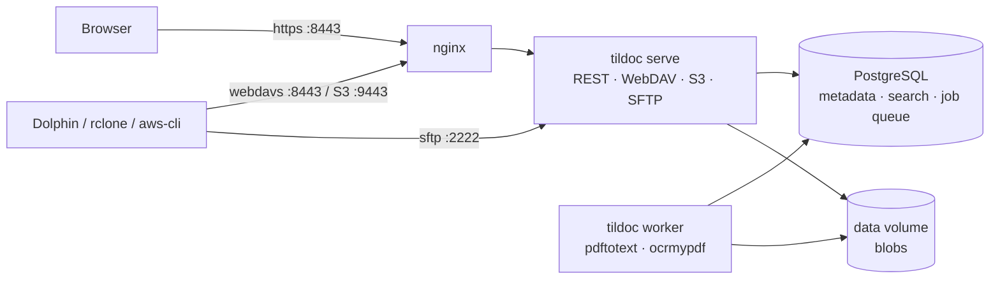

# tildoc

Self-hosted, multi-user document management. Every file type is accepted and
stored immutably; PDFs and text files get text extraction, OCR (scanned PDFs →
searchable PDF) and full-text search. Documents live in **Spaces** (personal or
team-owned) with a real folder tree, reachable through a web UI and as a network
filesystem via **WebDAV**, **SFTP** and an **S3-compatible API**: Dolphin/KDE on
Arch Linux works natively.

## Core semantics

| Concept | Behaviour |
|---------|-----------|
| **Originals are sacred** | Uploaded bytes are never modified. Blobs are content-addressed (SHA-256). Derived data (text, searchable PDF) is stored separately. |
| **Never store twice** | A file whose SHA-256 already exists in the space is not stored again; it only gets a new **Link** (folder + name) to the existing document. Across spaces the blob is shared, metadata is not. |
| **Links** | A document can appear in several folders. Every document shows all its links (UI, WebDAV prop `tildoc:links`, S3 header `x-amz-meta-tildoc-links`). |
| **Versions** | Overwriting a file creates a new version (UI, S3 `PUT`, WebDAV `PUT`/`MOVE` over a file, SFTP posix-rename). Old versions stay downloadable/restorable. |
| **Copy-on-write** | Writing through one link of a multi-linked document forks that link into its own document (history copied). |
| **Provenance** | The path a file was imported at is kept forever. Files can be remapped freely and moved back with "Original location". |
| **Trash** | Deleting a link removes only that link. A document goes to the trash with its last link and is purged after the retention period (default 30 days). |

Glossary: **Team** (users + roles owner/admin/member/viewer), **Space**
(container, = S3 bucket, = top-level WebDAV/SFTP folder), **Folder**,
**Document**, **Link**, **Version**, **Blob** (internal). See [PLAN.md](PLAN.md)
for design details and decisions.



## Quick start (Docker Compose)

```
cp deploy/.env.example deploy/.env
# edit deploy/.env: set TILDOC_MASTER_KEY and POSTGRES_PASSWORD, e.g.
openssl rand -base64 32
docker compose -f deploy/docker-compose.yml --env-file deploy/.env up -d --build
```

Open `https://localhost:8443` and create the administrator account. The setup
form works only while no account exists, so do this right after the first start.

On first start nginx generates a self-signed certificate. For production, mount
real certificates (`fullchain.pem`, `privkey.pem`) into the `certs` volume
(`/etc/nginx/certs`) and set `TILDOC_SERVER_NAME` / `TILDOC_PUBLIC_URL`.

| Port | Service |
|------|---------|
| 8443 | Web UI, REST API (`/api`), WebDAV (`/dav`), all via nginx TLS |
| 9443 | S3 API via nginx TLS (path-style: `https://host:9443/<space-slug>/<key>`) |
| 2222 | SFTP (SSH, direct) |

Admin CLI (inside the server container):

```
docker compose -f deploy/docker-compose.yml exec server tildoc user create -username bob
docker compose -f deploy/docker-compose.yml exec server tildoc user passwd -username bob
```

### Configuration

All settings are `TILDOC_*` environment variables (template: `deploy/.env.example`).

| Variable | Default | Meaning |
|----------|---------|---------|
| `TILDOC_DATABASE_URL` | required | PostgreSQL URL |
| `TILDOC_MASTER_KEY` | required | 32 bytes base64; encrypts access-key secrets. **Back it up.** |
| `TILDOC_DATA_DIR` | `./data` | Blob store + SSH host key |
| `TILDOC_HTTP_ADDR` / `_S3_ADDR` / `_SFTP_ADDR` | `:8080` / `:9000` / `:2222` | listeners (`SFTP_ADDR=off` disables SFTP) |
| `TILDOC_PUBLIC_URL`, `_S3_PUBLIC_URL`, `_SFTP_PUBLIC_ADDR` | localhost | shown in the UI's connection help |
| `TILDOC_TRUSTED_PROXIES` | – | CIDRs whose `X-Forwarded-For` is trusted (rate limiting) |
| `TILDOC_TRASH_RETENTION` | `30d` | trash purge delay |
| `TILDOC_MAX_UPLOAD_BYTES` | 50 GiB | per-file limit |
| `TILDOC_OCR_ENABLED` / `_OCR_LANGS` | `true` / `deu+eng` | OCR via ocrmypdf/tesseract (worker image ships deu+eng) |
| `TILDOC_WORKER_CONCURRENCY` | `2` | parallel processing jobs |
| `TILDOC_COOKIE_SECURE` | `true` | set `false` only for plain-HTTP development |

## Connecting from Arch Linux / KDE

Create an **access key** in *Settings & access*. Its secret is the password for
WebDAV and SFTP and the S3 secret key. Account passwords are deliberately not
accepted by these protocols. Keys can be limited to one space and/or read-only.

### Dolphin via WebDAV (recommended)

Built into KDE (`kio-extras`). Enter in Dolphin's location bar:

```
webdavs://<username>@<host>:8443/dav/
```

Password: the access key secret (KWallet can store it). With the self-signed
certificate KIO asks once to accept it. To keep it in the sidebar: *Network →
Add Network Folder → WebDAV*, server `<host>`, port `8443`, folder `/dav/`,
"Use encryption" on.

Each top-level folder is a space. Dolphin's "safe save" (`file.part` + rename)
becomes a new version of the target file, not a new document.

### Dolphin via SFTP

```
sftp://<username>@<host>:2222/
```

Authenticate with an SSH key registered under *Settings & access → SSH keys*,
or with an access key secret as password. Verify the host key fingerprint on
first connect against the one the server logs at startup:

```
docker compose -f deploy/docker-compose.yml logs server | grep host_key
```

### S3 with rclone (mount or sync)

```
sudo pacman -S rclone fuse3
```

`~/.config/rclone/rclone.conf` (the UI shows a ready-made snippet after creating a key):

```
[tildoc]
type = s3
provider = Other
access_key_id = <key id>
secret_access_key = <secret>
endpoint = https://<host>:9443
region = us-east-1
directory_markers = true
```

With the self-signed certificate, add `ca_cert = /path/to/fullchain.pem`
(copy it out with `docker compose -f deploy/docker-compose.yml cp nginx:/etc/nginx/certs/fullchain.pem .`)
or use `--no-check-certificate` for testing.

Mount as a systemd user service, `~/.config/systemd/user/tildoc-mount.service`:

```
[Unit]
Description=tildoc S3 mount (rclone)
After=network-online.target

[Service]
Type=notify
ExecStartPre=/usr/bin/mkdir -p %h/tildoc
ExecStart=/usr/bin/rclone mount tildoc: %h/tildoc --vfs-cache-mode writes --dir-cache-time 30s
ExecStop=/usr/bin/fusermount3 -u %h/tildoc
Restart=on-failure

[Install]
WantedBy=default.target
```

```
systemctl --user daemon-reload
systemctl --user enable --now tildoc-mount.service
```

Notes: S3 has no rename, so a rename via S3 is copy + delete. tildoc keeps
document identity (the copy links the same document). WebDAV and SFTP rename
natively. `directory_markers = true` makes empty folders and `rmdir` work.
Changes made elsewhere show up in the mount after `--dir-cache-time`.

## Development

Requirements: Go ≥ 1.27, Node ≥ 24, Docker. `pdftotext` (poppler) locally is optional.

```
make test          # unit + integration tests (starts a PostgreSQL test container)
make test-docker   # all tests incl. OCR inside a container with poppler/ocrmypdf/tesseract
make e2e           # real clients: aws-cli + rclone (S3, WebDAV, SFTP) against a local build
test/e2e/compose.sh  # full docker compose stack incl. nginx/TLS and OCR worker
test/ui/run.sh     # UI smoke test in Chromium (playwright-core, uses /usr/bin/chromium)
scripts/dev.sh     # run locally: PostgreSQL container + `tildoc all` on :8080 (UI from web/build)
cd web && npm run dev   # UI dev server with proxy to :8080
```

Layout:

```
cmd/tildoc        single binary: serve | worker | all | migrate | user | health
internal/core      domain logic (only package touching DB + blob store)
internal/vfs       path-based filesystem view used by WebDAV, SFTP, S3
internal/api       REST API + UI serving       internal/s3     S3 gateway (SigV4, aws-chunked, multipart)
internal/dav       WebDAV gateway              internal/sftpd  SFTP gateway
internal/worker    job runner + processors     internal/blob   content-addressed blob store
internal/db        pool, embedded migrations   internal/testutil  test harness, PDF generator
web/               SvelteKit UI (static SPA)   deploy/         compose, nginx template, env template
```

## Security notes

- Passwords: argon2id. Sessions: random tokens stored hashed, `HttpOnly` +
  `SameSite=Strict` cookies; cookie-authenticated writes require the
  `X-Tildoc-CSRF` header.
- Access-key secrets are encrypted at rest (AES-256-GCM, `TILDOC_MASTER_KEY`),
  because SigV4 needs the plaintext secret server-side.
- Failed logins (UI, WebDAV, SFTP, S3 signatures) are rate limited per IP and login.
- File content is never rendered as active content on the UI origin: downloads are
  attachments, inline preview only for PDF/text/images, `CSP: sandbox` + `nosniff`.
  The UI ships a strict hash-based CSP.
- Deduplication is server-side only. There is no "do you have hash X" endpoint
  that could reveal other users' files.
- **Backups** need all three: PostgreSQL (`pg_dump`), the `data` volume (blobs,
  SSH host key) and `TILDOC_MASTER_KEY`.
