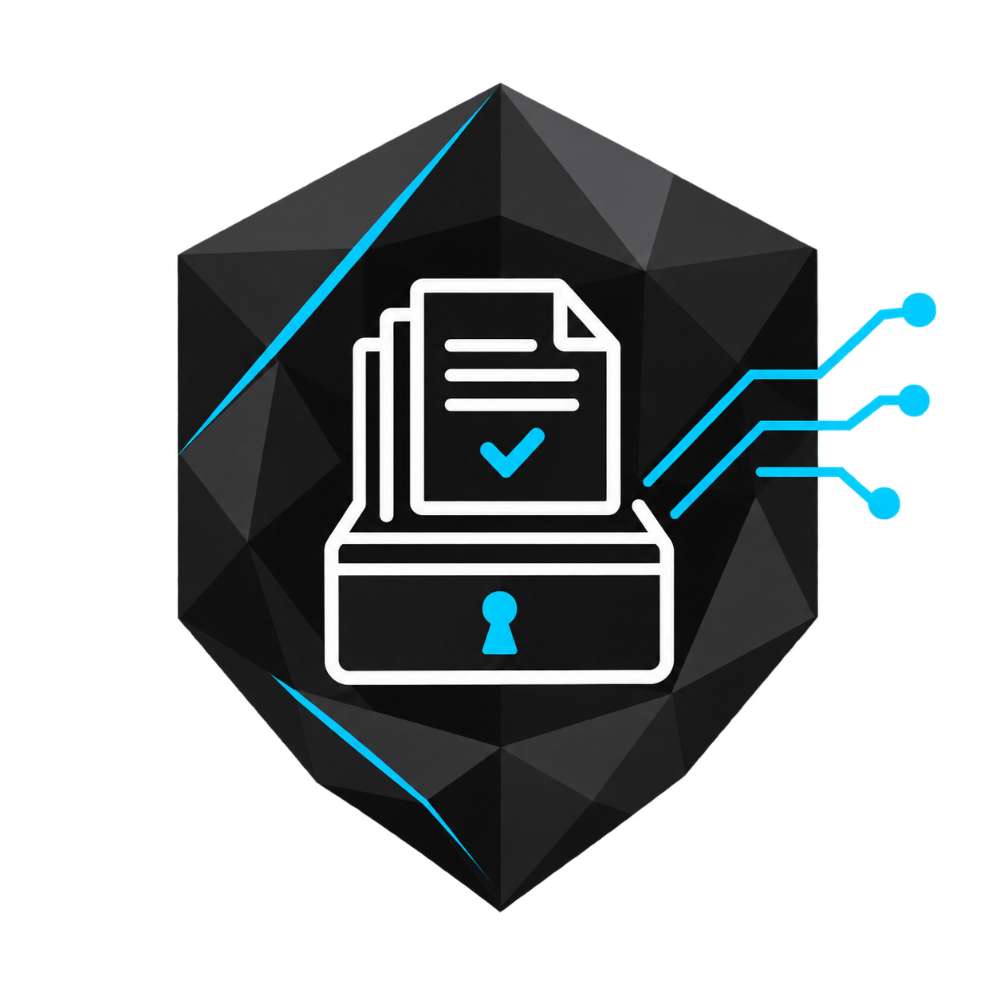
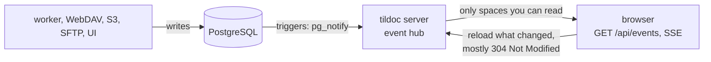
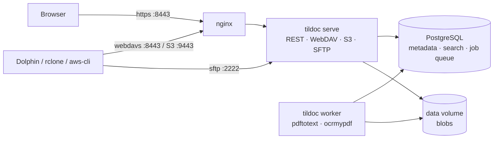

# tildoc

Self-hosted, multi-user document management. Every file type is accepted and
stored immutably; PDFs and text files get text extraction, OCR (scanned PDFs →
searchable PDF) and full-text search. Documents live in **Spaces** (personal or
team-owned) with a real folder tree, reachable through a web UI and as a network
filesystem via **WebDAV**, **SFTP** and an **S3-compatible API**: Dolphin/KDE on
Arch Linux works natively.

## Core semantics

| Concept | Behaviour |
|---------|-----------|
| **Originals are sacred** | Uploaded bytes are never modified. Blobs are content-addressed (SHA-256). Derived data (text, searchable PDF) is stored separately. |
| **Never store twice** | A file whose SHA-256 already exists in the space is not stored again; it only gets a new **Link** (folder + name) to the existing document. Across spaces the blob is shared, metadata is not. |
| **Links** | A document can appear in several folders. Every document shows all its links (UI, WebDAV prop `tildoc:links`, S3 header `x-amz-meta-tildoc-links`). |
| **Versions** | Overwriting a file creates a new version (UI, S3 `PUT`, WebDAV `PUT`/`MOVE` over a file, SFTP posix-rename). Old versions stay downloadable/restorable. |
| **Copy-on-write** | Writing through one link of a multi-linked document forks that link into its own document (history copied). |
| **Provenance** | The path a file was imported at is kept forever. Files can be remapped freely and moved back with "Original location". |
| **Trash** | Deleting a link removes only that link. A document goes to the trash with its last link and is purged after the retention period (default 30 days). Purging (also emptying the trash) deletes the content at once, incl. extracted text and OCR variants, unless another document still uses the same content; uploading it again later is processed from scratch. |

## Web UI

Folders on the left, files in the middle, a resizable preview on the right in
which the whole document scrolls. Clicking a row shows the preview (Space
toggles it). Clicking the file name (or Enter, double click) shows the
document full-window: continuous pages, thumbnails, zoom, find in document
with highlighted hits (Ctrl+F), original vs. OCR version, versions and places
in a details drawer, `[`/`]` for the previous/next document in the folder,
Esc to close. The address bar always names the selected file
(`/f/<folder>?sel=<file>`); sending that URL opens the same folder with the
file selected and previewed for anyone who can read the space. Ctrl+K searches everywhere; a hit opens on the right page with
the terms highlighted. PDFs are rendered with pdf.js; the browser's built-in
viewer can be chosen instead under *Settings and access → Opening documents*.

### Live updates and speed

The UI stays current without reloading: processing status ("Queued" →
"Indexed"), files and folders added through WebDAV, SFTP, S3 or by other
people, tags, versions and import progress appear as they happen.



- Events carry only ids ("something in space X / document Y changed"); the
  browser reloads through the normal API, so permissions are checked as
  usual. Without the stream (proxy, network) the UI falls back to polling.
- API JSON is gzipped and has an `ETag`; the UI keeps visited folders and
  documents in memory, shows them at once and revalidates (`304`).
  Responses stay `no-store`: nothing authenticated lands in the browser's
  disk cache.
- The UI build is precompressed (`.br`, `.gz`); tildoc and nginx serve the
  compressed files. Large folders only render the visible rows. Find in a
  PDF uses the server's extracted text to skip pages without hits, so only
  those pages of a large scan are loaded. Hovering a file name preloads the
  viewer and pdf.js.
- Reverse proxies other than the bundled nginx must not buffer
  `/api/events` (tildoc sends `X-Accel-Buffering: no`) and should allow
  idle reads of at least 30 s (heartbeat every 25 s).

### Editing text files

Opening a text file (`text/*`, up to 5 MB, UTF-8) opens it in an editor;
the preview stays read-only. Ctrl+F searches and replaces, Alt+↑/↓ moves
lines, Shift+Alt+↓ duplicates, Ctrl+Z undoes; Markdown, JSON, XML/HTML,
YAML, CSS and JavaScript are highlighted. Ctrl+S (or *Save…*) shows the
changes as a diff first; confirming saves a new version (source *Editor* in
the history).

Only one person edits a document at a time: the editing window holds a
lease, renewed every 5 s and free again 15 s after the window closed or lost
its connection. Others see the text read-only, follow saved versions live and
can edit as soon as it is free. WebDAV, SFTP and S3 are not blocked: if a
version arrives that way while you edit, you are warned and the review
compares with it; your save becomes the newest version, the other stays in
the history.

### Editing office documents

With an office server (optional, see below), `.docx`, `.xlsx`, `.pptx`, `.odt`
and the other types it supports open as a web application in the full viewer.
Several people can edit at the same time. Saves during the session are kept
as a working copy; **when the last person closes the document it becomes one
new version** (source "Office"). If the office server crashes or loses its
connection, the working copy becomes a version after 30 minutes. Users without
write access get the document read-only. WebDAV, SFTP and S3 keep showing the
last version until the session ends, and are not blocked: the last save wins.
While a session runs, the file shows "In Office".

"New file" in a folder creates a text file with any ending, or any format the
office server can create (with ONLYOFFICE: text documents, spreadsheets,
presentations, PDFs and their templates). PDFs open in the PDF viewer; "Edit in Office" opens them in
the office server.

### Permissions and sharing

Admins define **roles** (sets of permissions, on spaces or the server). On
every space, a matrix of people and **teams** decides who can do what: each row
is a role plus individually added permissions. Permissions only add up. The
owner of a space (a person, or a team's managers) always has everything, and
ownership can be transferred. Administrators can't read documents.

A **Restricted viewer** can read in the browser, but nothing offers a download
or export, and WebDAV, SFTP, S3 and copies are refused.

Sharing, each variant separately allowed through the matrix:

| | Space | File |
|---|---|---|
| People and teams | yes | yes ("Shared with me") |
| Link for signed-in users | yes | yes |
| Public link, no account | yes | yes |
| Drop link: upload only | yes | no |

Each space has settings, all off by default: sign-in links, public links, drop
links and file shares must be enabled there before they can be used. **Write
protection** stops all changes, by anyone and on every channel, until it is
switched off. **No tildoc OCR** stops the OCR and the image-only variant for
that space. Originals are never changed either way.

Links can have a password and an expiry, are shown once, and stop working when
their creator loses the rights behind them. Public and drop links are off
until an administrator enables them. A drop link accepts anonymous uploads, so
it can fill the disk up to the upload limit: give it an expiry.

**Drop-In tokens** let scripts and devices send files in, and nothing else
(enable "Drop-In tokens" in the space's settings):

```
curl -T file.pdf -H "Authorization: Bearer tildoc_…" https://host/api/drop/
```

**API keys** (Settings): `Authorization: Bearer tildoc_…` for the REST API,
limited to chosen permissions and spaces, never more than their owner can do.

### Places

*Places* in the document details lists where the document appears, plus
where identical content lives in other spaces you can read (e.g. the same
invoice in your personal and a team space). Such content is stored and
processed once, but it is a separate document per space with its own
versions and tags.

### Tags and collections

**Tags** are one list for the whole server. Anyone can create a tag while
tagging a document (the tags are chips inside the tag box: Enter or comma
adds, Backspace in the empty box removes the last); administrators rename, merge and delete tags. A tag sits
on the document, so every place it appears shows it. Search filters by tag,
S3 clients can use object tagging (`aws s3api put-object-tagging`, the tag key
is the name), WebDAV exposes `tildoc:tags`.

**Collections** group documents across spaces, for example all bills for the
tax return from your personal space and a team space. They are personal or
belong to a team, can include every document with a given tag, and never
grant access: everyone only sees the documents of spaces they can read.
In WebDAV and SFTP they appear read-only under `/@collections/<name>/`.

### Sharing

A space belongs to a person or a team. Owners and admins can additionally
share it with single people or whole teams as viewer, member or admin
(*Spaces → Share*). A team member never gets more than their role in that
team, and nobody can grant more than they have.

### Export, import, backup

- **Export as ZIP** (space, folder, collection): the current files in the
  structure and names you see. Opens anywhere.
- **Export** (space, collection, `.tildoc`): everything incl. versions, places,
  original paths, tags, collections and OCR results, for another tildoc server.
  *Spaces → Import a space* turns it into a new space; *Import* in a folder adds
  a bundle or a ZIP there. Imports follow the upload rules: files already stored
  are not stored again, identical content joins the existing document.
- **Server backups** (*Administration → Backups* or `tildoc backup full|differential`):
  full backups hold everything incl. trash, users and keys; differential backups
  only the files added since the last full one. They stay on the server in
  `TILDOC_BACKUP_DIR` (`backups` volume); copy them off yourself:

```
docker compose -f deploy/docker-compose.yml cp worker:/backups ./backups
docker compose -f deploy/docker-compose.yml exec worker tildoc backup verify /backups/FULL.dtbackup /backups/DIFF.dtbackup
```

  Restore into an empty server with the same `TILDOC_MASTER_KEY`:

```
docker compose -f deploy/docker-compose.yml exec worker tildoc restore /backups/FULL.dtbackup [/backups/DIFF.dtbackup]
```

Format: [docs/bundle-format.md](docs/bundle-format.md).

### OCR variants

Scans without text get tildoc's OCR as an additional searchable PDF. Scans
that arrive with someone else's OCR keep it; tildoc additionally strips the
text to an image-only copy and runs its own OCR on it. *Administration → OCR*
decides which text search uses. When tildoc's own OCR PDF comes back as a
new version (downloaded and uploaded again), it is recognised and not OCRed
a second time.

### History

*History* in the document details shows versions and variants as one graph,
oldest first: versions on the main line, derived variants branching off
(original → image only → tildoc OCR), and lines joining back where a version
continues from a variant (e.g. the OCR PDF uploaded as a new version) or
restores an older version (dashed). Clicking a node shows it (version and
variant) in the preview or viewer, and only that node is marked; *Open* opens
exactly the selected node. Every node can be downloaded, older versions
restored. Selecting
or opening a file always starts at its latest node: the newest version and,
if it has variants, the newest of them (e.g. tildoc's OCR).

Glossary: **Team** (users + roles owner/admin/member/viewer), **Space**
(container, = S3 bucket, = top-level WebDAV/SFTP folder), **Folder**,
**Document**, **Link**, **Version**, **Blob** (internal). See [PLAN.md](PLAN.md)
for design details and decisions.



## Quick start (Docker Compose)

```
cp deploy/.env.example deploy/.env
# edit deploy/.env: set TILDOC_MASTER_KEY and POSTGRES_PASSWORD, e.g.
openssl rand -base64 32
docker compose -f deploy/docker-compose.yml --env-file deploy/.env up -d --build
```

Open `https://localhost:8443` and create the administrator account. The setup
form works only while no account exists, so do this right after the first start.

On first start nginx generates a self-signed certificate. For production, mount
real certificates (`fullchain.pem`, `privkey.pem`) into the `certs` volume
(`/etc/nginx/certs`) and set `TILDOC_SERVER_NAME` / `TILDOC_PUBLIC_URL`.

| Port | Service |
|------|---------|
| 8443 | Web UI, REST API (`/api`), WebDAV (`/dav`), all via nginx TLS |
| 9443 | S3 API via nginx TLS (path-style: `https://host:9443/<space-slug>/<key>`) |
| 2222 | SFTP (SSH, direct) |

Admin CLI (inside the server container):

```
docker compose -f deploy/docker-compose.yml exec server tildoc user create -username bob
docker compose -f deploy/docker-compose.yml exec server tildoc user passwd -username bob
```

### Configuration

All settings are `TILDOC_*` environment variables (template: `deploy/.env.example`).

| Variable | Default | Meaning |
|----------|---------|---------|
| `TILDOC_DATABASE_URL` | required | PostgreSQL URL |
| `TILDOC_MASTER_KEY` | required | 32 bytes base64; encrypts access-key secrets. **Back it up.** |
| `TILDOC_DATA_DIR` | `./data` | Blob store + SSH host key |
| `TILDOC_HTTP_ADDR` / `_S3_ADDR` / `_SFTP_ADDR` | `:8080` / `:9000` / `:2222` | listeners (`SFTP_ADDR=off` disables SFTP) |
| `TILDOC_PUBLIC_URL`, `_S3_PUBLIC_URL`, `_SFTP_PUBLIC_ADDR` | localhost | shown in the UI's connection help |
| `TILDOC_TRUSTED_PROXIES` | – | CIDRs whose `X-Forwarded-For` is trusted (rate limiting) |
| `TILDOC_TRASH_RETENTION` | `30d` | trash purge delay |
| `TILDOC_MAX_UPLOAD_BYTES` | 50 GiB | per-file limit |
| `TILDOC_OCR_ENABLED` / `_OCR_LANGS` | `true` / `deu+eng` | OCR via ocrmypdf/tesseract (worker image ships deu+eng; Tesseract is built from the pinned source release in the `Dockerfile`, `ARG TESSERACT_VERSION`) |
| `TILDOC_WORKER_CONCURRENCY` | `2` | parallel processing jobs |
| `TILDOC_COOKIE_SECURE` | `true` | set `false` only for plain-HTTP development |
| `TILDOC_BACKUP_DIR` | `<data dir>/backups` | where server backups are written (compose: `/backups` volume) |
| `TILDOC_OCR_REDO_FOREIGN` | `true` | add tildoc's OCR to PDFs that come with a foreign OCR layer |

### Sign in with Google

Optional. Create an OAuth client of type "web application" in Google Cloud with
the redirect URI `<TILDOC_PUBLIC_URL>/api/auth/google/callback`, then set in
`deploy/.env`:

```
TILDOC_GOOGLE_CLIENT_ID=...
TILDOC_GOOGLE_CLIENT_SECRET=...
```

A first sign-in creates an account that waits for approval on the Access page.

### Office documents

Optional: Collabora Online or ONLYOFFICE as a separate container, on its own
subdomain. Setup, testing and switching: [docs/office-servers.md](docs/office-servers.md).
Without `TILDOC_OFFICE_URL` the feature is off.

## Connecting from Arch Linux / KDE

Create an **access key** in *Settings & access*. Its secret is the password for
WebDAV and SFTP and the S3 secret key. Account passwords are deliberately not
accepted by these protocols. Keys can be limited to one space and/or read-only.

### Dolphin via WebDAV (recommended)

Built into KDE (`kio-extras`). Enter in Dolphin's location bar:

```
webdavs://<username>@<host>:8443/dav/
```

Password: the access key secret (KWallet can store it). With the self-signed
certificate KIO asks once to accept it. To keep it in the sidebar: *Network →
Add Network Folder → WebDAV*, server `<host>`, port `8443`, folder `/dav/`,
"Use encryption" on.

Each top-level folder is a space. Dolphin's "safe save" (`file.part` + rename)
becomes a new version of the target file, not a new document.

### Dolphin via SFTP

```
sftp://<username>@<host>:2222/
```

Authenticate with an SSH key registered under *Settings & access → SSH keys*,
or with an access key secret as password. Verify the host key fingerprint on
first connect against the one the server logs at startup:

```
docker compose -f deploy/docker-compose.yml logs server | grep host_key
```

### S3 with rclone (mount or sync)

```
sudo pacman -S rclone fuse3
```

`~/.config/rclone/rclone.conf` (the UI shows a ready-made snippet after creating a key):

```
[tildoc]
type = s3
provider = Other
access_key_id = <key id>
secret_access_key = <secret>
endpoint = https://<host>:9443
region = us-east-1
directory_markers = true
```

With the self-signed certificate, add `ca_cert = /path/to/fullchain.pem`
(copy it out with `docker compose -f deploy/docker-compose.yml cp nginx:/etc/nginx/certs/fullchain.pem .`)
or use `--no-check-certificate` for testing.

Mount as a systemd user service, `~/.config/systemd/user/tildoc-mount.service`:

```
[Unit]
Description=tildoc S3 mount (rclone)
After=network-online.target

[Service]
Type=notify
ExecStartPre=/usr/bin/mkdir -p %h/tildoc
ExecStart=/usr/bin/rclone mount tildoc: %h/tildoc --vfs-cache-mode writes --dir-cache-time 30s
ExecStop=/usr/bin/fusermount3 -u %h/tildoc
Restart=on-failure

[Install]
WantedBy=default.target
```

```
systemctl --user daemon-reload
systemctl --user enable --now tildoc-mount.service
```

Notes: S3 has no rename, so a rename via S3 is copy + delete. tildoc keeps
document identity (the copy links the same document). WebDAV and SFTP rename
natively. `directory_markers = true` makes empty folders and `rmdir` work.
Changes made elsewhere show up in the mount after `--dir-cache-time`.

## Development

Requirements: Go ≥ 1.27, Node ≥ 24, Docker. `pdftotext` (poppler) locally is optional.
`npm run dev|build` first copies pdf.js assets and fonts into `web/static/vendor/` (generated).

```
make test          # unit + integration tests (starts a PostgreSQL test container)
make test-docker   # all tests incl. OCR inside a container with poppler/ocrmypdf/tesseract
make e2e           # real clients: aws-cli + rclone (S3, WebDAV, SFTP) against a local build
docker run --rm -v "$PWD":/app:ro -w /app golangci/golangci-lint:v2.15.0 golangci-lint run  # lint as in CI
test/e2e/compose.sh  # full docker compose stack incl. nginx/TLS and OCR worker
test/ui/run.sh     # UI smoke test in Chromium (playwright-core, uses /usr/bin/chromium)
scripts/dev.sh     # run locally: PostgreSQL container + `tildoc all` on :8080 (UI from web/build)
cd web && npm run dev   # UI dev server with proxy to :8080
```

Layout:

```
cmd/tildoc        single binary: serve | worker | all | migrate | user | export | import | backup | restore | health
internal/core      domain logic (only package touching DB + blob store)
internal/vfs       path-based filesystem view used by WebDAV, SFTP, S3
internal/api       REST API + UI serving       internal/s3     S3 gateway (SigV4, aws-chunked, multipart)
internal/dav       WebDAV gateway              internal/sftpd  SFTP gateway
internal/worker    job runner + processors     internal/blob   content-addressed blob store
internal/db        pool, embedded migrations   internal/testutil  test harness, PDF generator
web/               SvelteKit UI (static SPA)   deploy/         compose, nginx template, env template
```

## Security notes

- Passwords: argon2id. Sessions: random tokens stored hashed, `HttpOnly` +
  `SameSite=Strict` cookies; cookie-authenticated writes require the
  `X-Tildoc-CSRF` header.
- Access-key secrets are encrypted at rest (AES-256-GCM, `TILDOC_MASTER_KEY`),
  because SigV4 needs the plaintext secret server-side.
- Failed logins (UI, WebDAV, SFTP, S3 signatures) are rate limited per IP and login.
- File content is never rendered as active content on the UI origin: downloads are
  attachments, inline content only for PDF/text/images, always with `CSP: sandbox`
  + `nosniff`. PDFs are drawn by pdf.js with PDF scripting off. Exception: users
  who choose the browser's built-in PDF viewer get unsandboxed inline PDFs (the
  browser refuses to run its viewer in a sandbox); the server checks that
  preference. The UI ships a strict hash-based CSP (`'wasm-unsafe-eval'` only for
  pdf.js image decoders, no JS eval).
- Live events (`GET /api/events`) carry only ids and are filtered per
  subscriber by the spaces it can read (re-checked every 30 s, streams end
  after 5 min and reconnect with a fresh authentication); max. 8 streams
  per user.
- Deduplication is server-side only. There is no "do you have hash X" endpoint
  that could reveal other users' files. Accepted limitation: text extraction
  and OCR results are shared per content, so uploading bytes that someone else
  already stored shows them as processed right away (this reveals that the
  identical file existed on the server, nothing about where or whose).
- **Office documents**: the office server handles untrusted files, so it runs on its
  own origin and cannot reach the tildoc session cookie or API. Its tokens are
  stored hashed, bound to one document and login session, and every WOPI call
  checks permissions again. Requests are verified with the server's proof key.
- **Backups**: server backups (see above) contain password hashes and encrypted
  access key secrets; keep them as safe as the server. They are not
  downloadable in the UI. Keep `TILDOC_MASTER_KEY` separately; without it
  restored access keys cannot be used. The byte-exact alternative remains
  `pg_dump` + the `data` volume + the master key.

## License

tildoc is dual-licensed:

- **Open source:** [GNU AGPL-3.0-only](LICENSE). You may use, modify and
  sell services with tildoc, including commercially, as long as you comply
  with the AGPL. In particular, if you modify tildoc and let users interact
  with it over a network, you must offer them the corresponding source code.
- **Commercial:** if you want to use tildoc without the AGPL obligations,
  for example in a proprietary product or a closed-source hosted service,
  a commercial license is available. Contact: tildoc@0x7e.eu

Bundled runtime dependencies: pdf.js (Apache-2.0), CodeMirror 6 (MIT).
Collabora Online CODE (MPL-2.0) and ONLYOFFICE Docs (AGPL-3.0) are optional,
separate containers and not part of tildoc.

## Contributing

Translations are welcome: see [docs/translating.md](docs/translating.md).

Contributions need a signed [Contributor License Agreement](CLA.md), because
of the dual licensing.
